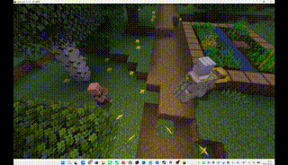
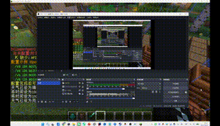
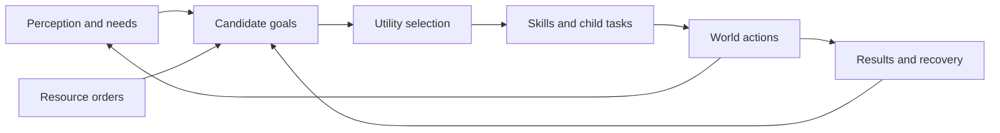

<div align="center">

# VillagerAgent

### A village that perceives, works, and cooperates.

Autonomous villagers for **Minecraft 1.16.5 · Forge 36.2.42 · Java 8**

[Getting started](#getting-started) · [Demos](#see-it-in-action) · [Architecture](#how-it-works) · [Documentation](docs/README.md)

</div>

---

VillagerAgent gives Minecraft villagers a state-driven behavior system: they remember nearby farmland, choose work and rest according to their needs, craft from real ingredients, and coordinate resource deliveries. When danger arrives, villagers call for help, gather eligible allies, and retreat when they can no longer fight.

The core simulation runs **without an API key**. An optional LLM adds richer conversations and other language-based interactions, while skills and world-state checks govern execution.

## See it in action

### Trading — goods change hands

Villagers approach each other, throw items, and collect them into their inventories. Directed two-way trades complete the first delivery before starting the return delivery.



### Combat — call for help, rally, and retreat

Villagers react to threats through shared calls for help. Charging depends on allies actually arriving, carrying weapons, and meeting health and fatigue requirements.



## What villagers can do

| | Capability | In the world |
|---|---|---|
| 🌾 | **Farm and remember** | Revisit observed fields, harvest, replant, collect crops, and till connected farmland with real tools |
| 🪵 | **Cooperate on supplies** | Lumberjack and miner roles claim resource orders, gather reachable materials, and deliver against actual inventory shortages |
| 🔨 | **Craft from ingredients** | Plan ordinary crafting-table dependencies, retain leftover materials, and travel to remembered tables for 3×3 recipes |
| 🤝 | **Trade and socialize** | Exchange inventory items, converse with neighbors, update relationships, and share resource-location knowledge |
| 🛏️ | **Rest when tired** | Find beds and recover from fatigue, with urgent needs able to interrupt ordinary work |
| 🛡️ | **Respond to danger** | Call for help, rally armed allies, and stop fighting when the group or individual becomes ineligible |
| 🧭 | **Perceive their surroundings** | Combine chunk memories, a bed-anchored building index, and near-field observations |
| 🧱 | **Interact with blocks** | Break and place blocks through world actions; explicit commands also support structure-building requests |

## How it works



**Choose from current conditions.** Slow updates maintain opportunities and needs. A Utility scheduler samples feasible goals by weight while respecting cooldowns, task continuity, and urgent preemption.

**Execute in the world.** Skills advance every server tick. Composite tasks coordinate children such as movement, harvesting, and planting; inventory and block changes provide completion evidence.

**Recover from failure.** Structured results distinguish progress, waiting, missing prerequisites, and failure. Cleanup releases actions and leases, and recovery can request supplies or create crafting goals.

The optional LLM participates at defined integration points such as conversations. The general Harness daily-goal planner is not connected to the main loop. See [implementation boundaries](docs/implementation_status.md) for the supported scope and remaining limitations.

## Getting started

### 1. Build

Use a **Java 8 JDK** and the included Gradle wrapper:

```powershell
.\gradlew.bat build --console=plain
```

The mod JAR is written to `build/libs/`. For a development client:

```powershell
.\gradlew.bat runClient
```

### 2. Install

Place the built mod JAR in the `mods/` directory of a **Minecraft 1.16.5 / Forge 36.2.42** instance, then launch the game. Rule-based behavior works without configuring an LLM.

### 3. Explore

Use `/va` (or `/villageragent`) with in-game completion. Resource commands apply to the nearest managed villager:

```text
/va info
/va occupation lumberjack
/va request minecraft:oak_log 8
/va orders
```

To try a supply request, issue it near the requester and assign the resource role near a **different** adult villager. Provide reachable natural trees or exposed resources. AI, world interaction, and economy must be enabled.

For directed exchanges and crafting, see the [trade and crafting walkthrough](docs/configuration_and_operation.md#directed-two-way-trade-and-crafting-demonstrations).

### Optional: enable LLM interactions

Configure your provider through `/va llm apitype`, `/va llm apiurl`, `/va llm model`, and `/va llm apikey`, then check:

```text
/va llm status
```

Provider options include OpenAI-compatible APIs, Anthropic, Ollama, and Gemini. Runtime settings live in `config/villageragent-common.toml`; external data lives in `config/villageragent/`. See [configuration and operation](docs/configuration_and_operation.md) for details.

## Documentation

| Start here | Go deeper |
|---|---|
| [Documentation guide](docs/README.md) | [Execution pipeline and resource orders](docs/execution_pipeline_and_resource_orders.md) |
| [Configuration and commands](docs/configuration_and_operation.md) | [Capabilities, crafting, and economy](docs/capabilities_crafting_and_economy.md) |
| [Source code index](docs/CODE_INDEX.md) | [Spatial perception](docs/vision_module_implementation.md) |
| [Debugging and verification](docs/DEBUG_VERIFICATION.md) | [Events, knowledge sharing, and combat](docs/events_and_knowledge_sharing.md) |
| [Implementation status](docs/implementation_status.md) | [LLM and world interaction](docs/llm_and_world_interaction.md) |

## Development and verification

```powershell
.\gradlew.bat check --console=plain
```

Automated checks cover selected order, scheduling, lifecycle, and nested-task rules. Real navigation, entity loading, block interactions, and presentation require the [in-game verification scenarios](docs/DEBUG_VERIFICATION.md).

For changes, start with [AGENTS.md](AGENTS.md) and the current documentation. Contributions and reproducible bug reports are welcome through [GitHub Issues](https://github.com/Aaron-AA0721/MinecraftMod-VillagerAgent/issues).
