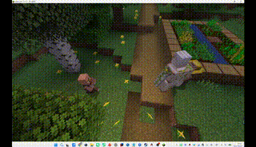
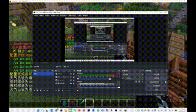
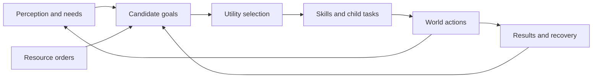

<div align="center">

# VillagerAgent

### A village that perceives, works, and cooperates.

Autonomous villagers for **Minecraft 1.16.5 · Forge 36.2.42 · Java 8**

[Getting started](#getting-started) · [Demos](#see-it-in-action) · [Architecture](#how-it-works) · [Documentation](docs/README.md)

</div>

---

VillagerAgent gives Minecraft villagers a state-driven behavior system: they remember nearby farmland, choose work and rest according to their needs, work their own trade, craft from real ingredients, and coordinate deliveries through a village notice board. A miner whose pickaxe breaks posts a request; the toolsmith takes the iron ore on offer, asks the lumberjack for wood, forges the pickaxe, and carries it over. When danger arrives, villagers call for help, gather eligible allies, and retreat when they can no longer fight.

The core simulation runs **without an API key**. An optional LLM plans what a villager does next from the same goal vocabulary the rules use — including inviting neighbours to join in — while skills, validation, and world-state checks govern execution.

## See it in action

### Trading — goods change hands

Villagers approach each other, throw items, and collect them into their inventories. Directed two-way trades complete the first delivery before starting the return delivery.



### Combat — call for help, rally, and retreat

Villagers react to threats through shared calls for help. Charging depends on allies actually arriving, carrying weapons, and meeting health and fatigue requirements.



### Supply chains — one tool, three villagers

`/va demo pickaxe` films the whole cooperative loop end to end: the miner works until his pickaxe breaks, posts a pickaxe request and offers his spare iron ore, the toolsmith claims the ore and asks the village for wood, the lumberjack answers with logs, and the finished pickaxe comes back to the miner. Each step nudges the villager whose turn it is and waits for the systems to do the work; if one stalls, the step forces its outcome so a recording never dead-ends.

```text
/va demo pickaxe                      # auto-picks a miner, toolsmith and lumberjack nearby
/va demo invite Alice Bob 30           # Alice invites Bob over, then they eat and chat
/va demo gift Alice Bob minecraft:bread 2
/va demo stop
```

## What villagers can do

| | Capability | In the world |
|---|---|---|
| 🌾 | **Farm and remember** | Revisit observed fields, harvest, replant, collect crops, and till connected farmland with real tools |
| ⛏️ | **Work their own trade** | Each profession has its own work session: fell trees, mine ores, fish, shear sheep, tend and slaughter livestock, cook meat, dig gravel and fletch arrows, smelt ore and collect it from the furnace, restock at the workstation |
| 🪵 | **Cooperate on supplies** | Post requests and offers on the village notice board, claim another villager's order, gather or craft what is missing, and deliver against real inventory shortages |
| 🔨 | **Craft from ingredients** | Plan crafting-table dependencies, acquire the inputs they lack, retain leftover materials, and travel to remembered tables for 3×3 recipes |
| 🤝 | **Trade, gift, and socialize** | Exchange inventory items, hand over presents they can spare, converse with neighbors, update relationships, and share resource-location knowledge |
| 🎉 | **Do things together** | Invite neighbours to a meal or a stroll, or ask them for a favour; guests gather, take part, and stay until the plan ends |
| 🛏️ | **Rest when tired** | Find beds and recover from fatigue, with urgent needs able to interrupt ordinary work |
| 🛡️ | **Respond to danger** | Call for help, rally armed allies, and stop fighting when the group or individual becomes ineligible |
| 🧭 | **Perceive their surroundings** | Combine chunk memories, a bed-anchored building index, and near-field observations |
| 🧱 | **Interact with blocks** | Break and place blocks through world actions; explicit commands also support structure-building requests |

Which jobs a villager qualifies for follows from its profession and its skill levels, so an employed villager keeps only the routines it can actually do, and any villager with some farming skill can help in the fields as a hobby.

## Working together

Cooperation runs through things villagers can see and act on, not through a central planner.

**The notice board.** Villagers walk to the village notice board to read it, post what they want (`TRADE_WANT`) and what they can spare (`TRADE_HAVE`), and claim someone else's open request. A claim becomes a delivery goal for the provider, and the request is withdrawn once it is met — or kept open while the requester is still waiting on it.

**Supplying what you cannot make.** A villager that needs an item costs out its options: make it, buy it, or ask the village. Choosing the village posts a request; filling someone else's request can itself require inputs, so the chain continues outward until it reaches a villager who already has what is needed. What a villager will hand over excludes the tools of its own trade, so a toolsmith never gives away the pickaxe it works with.

**Directed trades.** `/va trade <first> <second> <first_item> <count> <second_item> <count>` arranges a two-way exchange between two named villagers; the first delivery completes before the return delivery starts.

**Group activities.** An invite is shared — the host walks to each guest, those who accept gather at the place and do the activity together, and the host takes part too. An ask is not: only those who agree carry it out. Both carry a short title a player can read, guests can decline when they are unable, and a plan can hold the group in place until a stated time. After a conversation, villagers sometimes follow up on their own with an invitation, a request, or a gift.

## What the LLM can do

With a provider configured, the LLM plans a villager's next actions from the same goal vocabulary the rules use, generated from the one table that also parses the reply:

| | |
|---|---|
| **Work and items** | `work` (optionally one part of the trade), `craft`, `acquire_item`, `trade`, `drop_item`, `pickup_item`, `harvest`, `plant`, `till`, `collect_crops`, `place_block` |
| **Moving and living** | `move`, `goto` a kind of building, `stroll`, `eat`, `cook` |
| **People** | `converse` with a villager or the nearest player, `socialize`, `gift` |
| **Plans** | `sequence` of steps done in order, `invite` others to join in, `ask` others to do something |

Plans can be timed (`at` an in-game clock time, or `in_seconds`), can run until a stated end, and carry a readable title. Every drafted goal is validated against the villager that would run it — its profession, skills, inventory, and whether the thing it names exists — before anything is queued, and routine-only behaviour such as resting and wandering stays out of the LLM's reach. Plans survive a restart.

```text
/va ask <villager> <message>      # let the LLM plan from what you say, and queue it
/va preview <villager> <message>  # see the plan it would make, without queueing it
/va goals clear                   # clear the nearest villager's queue
```

The chat panel's **Goals** button shows what a villager currently intends, in the order it means to do it.

## How it works



**Choose from current conditions.** Slow updates maintain opportunities and needs. A Utility scheduler samples feasible goals by weight while respecting cooldowns, task continuity, and urgent preemption.

**Execute in the world.** Skills advance every server tick. Composite tasks coordinate children such as movement, harvesting, and planting; inventory and block changes provide completion evidence.

**Recover from failure.** Structured results distinguish progress, waiting, missing prerequisites, and failure. Cleanup releases actions and leases, and recovery can request supplies or create crafting goals.

The optional LLM participates at defined integration points: conversations, the planning of queued goals, invitations and the replies to them. The general Harness daily-goal planner is not connected to the main loop. See [implementation boundaries](docs/implementation_status.md) for the supported scope and remaining limitations.

## Getting started

### 1. Build

Use a **Java 8 JDK** and the included Gradle wrapper:

```powershell
.\gradlew.bat build --console=plain
```

The mod JAR is written to `build/libs/`. For a development client:

```powershell
.\gradlew.bat runClient
```

### 2. Install

Place the built mod JAR in the `mods/` directory of a **Minecraft 1.16.5 / Forge 36.2.42** instance, then launch the game. Rule-based behavior works without configuring an LLM.

### 3. Explore

Use `/va` (or `/villageragent`) with in-game completion. Resource commands apply to the nearest managed villager:

```text
/va info
/va occupation lumberjack
/va request minecraft:oak_log 8
/va orders
/va demo pickaxe
```

To try a supply request, issue it near the requester and assign the resource role near a **different** adult villager. Provide reachable natural trees or exposed resources. AI, world interaction, and economy must be enabled.

For directed exchanges and crafting, see the [trade and crafting walkthrough](docs/configuration_and_operation.md#directed-two-way-trade-and-crafting-demonstrations).

### Optional: enable LLM interactions

Configure your provider through `/va llm apitype`, `/va llm apiurl`, `/va llm model`, and `/va llm apikey`, then check:

```text
/va llm status
```

Provider options include OpenAI-compatible APIs, Anthropic, Ollama, and Gemini. Runtime settings live in `config/villageragent-common.toml`; external data lives in `config/villageragent/`. See [configuration and operation](docs/configuration_and_operation.md) for details.

## Documentation

| Start here | Go deeper |
|---|---|
| [Documentation guide](docs/README.md) | [Execution pipeline and resource orders](docs/execution_pipeline_and_resource_orders.md) |
| [Configuration and commands](docs/configuration_and_operation.md) | [Capabilities, crafting, and economy](docs/capabilities_crafting_and_economy.md) |
| [Source code index](docs/CODE_INDEX.md) | [Spatial perception](docs/vision_module_implementation.md) |
| [Debugging and verification](docs/DEBUG_VERIFICATION.md) | [Events, knowledge sharing, and combat](docs/events_and_knowledge_sharing.md) |
| [Implementation status](docs/implementation_status.md) | [LLM and world interaction](docs/llm_and_world_interaction.md) |

## Development and verification

```powershell
.\gradlew.bat check --console=plain
```

Automated checks cover selected order, scheduling, lifecycle, and nested-task rules. Real navigation, entity loading, block interactions, and presentation require the [in-game verification scenarios](docs/DEBUG_VERIFICATION.md).

For changes, start with [AGENTS.md](AGENTS.md) and the current documentation. Contributions and reproducible bug reports are welcome through [GitHub Issues](https://github.com/Aaron-AA0721/MinecraftMod-VillagerAgent/issues).
