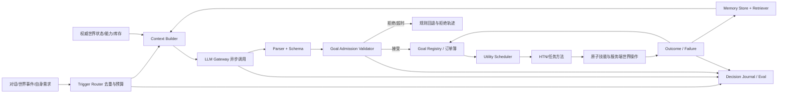

# LLM Harness 与 Villager Agent 架构

本文解释 Harness 的概念、一次决策的运行过程，以及如何让 LLM 根据对话和记忆提出目标，同时保持村民行为可验证、可执行、可回退。本文区分当前代码与建议演进方向；代码事实以源码为准。

## 1. Harness 是什么

Harness（运行脚手架/编排层）不是某个固定算法，也不必是第三方库。它是包围模型调用的应用层控制流程，负责把一次“问模型”变成一段受约束、可观测、能失败恢复的 Agent 运行：准备上下文、选择模型与提示、发起调用、解析结果、检查结果、提交状态变化、调用工具或执行器、记录轨迹，并对超时和错误降级。

简单的 LLM 调用是：

```text
prompt → LLM → text
```

Harness 管理的调用是：

```text
触发事件
  → 读取当前状态和相关记忆
  → 生成有限、结构化的请求
  → 异步调用模型（超时、并发控制、熔断）
  → 解析结构化提案
  → 校验权限、能力、世界状态、目标重复与预算
  → 将提案转成正式目标并写入目标池
  → Utility AI 选择时机
  → 规则技能执行并持续验证
  → 记录成功、失败和后续反馈
```

Harness 不会让模型自动变可靠。它提供可检查的边界，使错误提案被拒绝或安全降级，而不是直接变成世界操作。

## 2. 目标：模型可以提出新目标

村民大脑应允许 LLM 基于对话、事件、人格和相关记忆提出新目标，而不只是从现有候选里挑选。但模型输出先是**提案**，经过准入后才成为 `AgentGoal`。它不应直接执行方块破坏、物品转移或任意 Java 方法。

例如玩家说“请给我 8 个橡木木板”：

1. 对话事件解析出请求者、物品和数量，并保留原始对话作为证据。
2. Harness 检索“村民是否答应过玩家”“玩家偏好”等相关记忆，连同职业、库存、附近资源、现有订单和技能清单组成短上下文。
3. LLM 返回结构化目标提案，例如 `fulfill_request(item=minecraft:oak_planks, quantity=8, requester=<uuid>)`，可带简短理由和依据记忆 ID。
4. 规则校验数量范围、请求者身份、目标白名单、重复目标、村民是否能承接、是否存在可完成的任务分解方法，以及目标期限。
5. 接受后登记正式目标；资源订单系统可创建需求并处理认领/租约；Utility AI 后续决定何时开始或切换到它。
6. 技能/任务方法检查库存、找树、导航、按游戏时间破坏树木、收集掉落物、制作木板并交付；每一步的世界状态由服务端代码验证。
7. 完成或失败的结果写回目标生命周期和记忆。若模型建议的目标没有任何可执行分解方法，拒绝或标为等待能力补齐，不能让它成为永久 idle 来源。

目标提案与记忆必须分开：事实“玩家住在河边”存为记忆；意图“给玩家送木材”存为带来源、条件、期限和完成条件的目标。记忆可以支持未来推理，但不能仅因出现一条记忆就自动重复承诺或创建任务。

## 3. 一次 Harness 决策的详细运行过程

### 3.1 触发与去重

入口可以是玩家对话、村民对话、世界事件、资源需求、任务失败或低频反思。不同触发使用不同策略：玩家明确请求可立即解析；作物成熟可由规则直接建目标；反思适合低频调用。每个事件应有 ID 或稳定指纹，避免重试时重复创建同一目标。应设置每村民调用冷却、全局并发上限和每分钟预算。

### 3.2 构造上下文

只提供当前决策所需信息：身份与人格、当前需求、职业和技能、局部环境摘要、库存摘要、当前目标、最近失败、触发事件，以及检索出的少量相关记忆。不要把完整聊天历史或整个世界状态无界塞进 prompt。

将输入视为不可信数据。玩家消息和记忆文本是供模型理解的内容，不是能够覆盖系统规则的指令。工具权限和输出白名单由程序定义，不由 prompt 决定。

上下文构建也要明确“未知”：未扫描到矿脉不等于世界不存在矿脉；区块未加载意味着状态未知，不应让模型编造确定坐标。

### 3.3 请求模型

对游戏服务端采用异步请求，永不在实体 tick 或主线程等待网络。设置连接/响应超时、输出 token 上限、并发限制和熔断。超时、断网、限流或模型错误时，保留规则 AI 的工作，不清空目标、不阻塞移动与动作执行。

可用 JSON Schema、函数调用或受限解码降低格式错误率，但它们只保证输出形状，不保证行动合理。小模型通常更适合从短列表中选项、填少量参数、总结指定记忆；目标分解、世界验证与物理操作仍由代码承担。

### 3.4 解析、校验、接地

校验至少分为：

| 检查层 | 示例 |
|---|---|
| 结构 | action/goal 类型已知，字段类型和长度正确，数量在范围内 |
| 权限 | 该目标类型允许模型提出；不能伪造玩家 UUID 或调用任意工具 |
| 语义 | 数量合理；理由/参数与请求一致；不是把聊天语句误当成命令 |
| 能力 | 职业、工具、技能和任务分解方法支持完成该目标 |
| 世界接地 | 目标实体/方块仍存在，区块已加载，坐标在可达范围，资源尚未被耗尽 |
| 状态一致性 | 回调时村民仍存在且状态版本/触发事件仍有效；目标未被其他事件取消 |
| 目标治理 | 没有等价重复目标；目标池有空位；优先级、期限和资源成本受限 |

检查应在**提交目标时**执行，动作执行时还需再次检查动态世界条件。异步响应可能已经过时；因此在回到服务端线程时要重新读取权威状态，不能相信发请求时的快照仍然有效。

### 3.5 准入与目标登记

把模型 schema 映射到内部有限的目标类型，不让 LLM 自定义新 `goalType` 字符串并直接进入调度器。正式目标建议记录：

```text
id, type, parameters, source, requester, createdAt, expiresAt,
priority/importance, preconditions, successCondition, cancellationCondition,
deduplicationKey, evidenceMemoryIds, status
```

来源可为 `PLAYER_REQUEST`、`WORLD_EVENT`、`SELF_NEED`、`LLM_SUGGESTION`、`RECOVERY`。来源不是权限：无论来源如何都必须过规则校验。目标应有生命周期和取消路径，完成、过期、请求撤回、能力丢失或长期不可行时可以结束。

### 3.6 调度、分解与执行

Utility AI 在目标池中考虑可行性、当前需求、机会、紧迫性、重复抑制等，选择“现在做哪个”。被接受的目标并不保证立即执行，也不应绕过紧急规则和生存约束。

执行层把高层目标转换成任务方法和原子技能。例如“给玩家铁锭”可以分解成检查库存→若缺少则确认能否取得矿石→准备镐→寻找矿脉→导航→逐 tick 挖掘→拾取→熔炼→交付。每一步都可暂停、失败、等待或恢复；路径规划与方块交互使用游戏服务端规则。模型不能直接声称“已挖到”或修改库存。

### 3.7 结果、记忆和评测

记录触发源、上下文摘要/版本、模型与延迟、原始输出（注意隐私/文件大小）、解析结果、拒绝原因、正式目标 ID、执行结果和耗时。失败结果要区分模型失败、校验拒绝、没有技能、路径不可达、资源缺失和执行中断。

成功/失败可以成为短期事件记忆；长期记忆提炼应有去重、置信度、时间和来源。只有明确有训练或策略更新机制时才能称为“学习”；保存日志和记忆本身不等于模型自我改进。

## 4. 建议的组件边界



建议接口职责：

- `TriggerRouter`：将事件分类，去重，控制调用频率。
- `ContextBuilder`：以 token/字段预算构造当前输入；通过 `MemoryRetriever` 取相关记忆。
- `LLMGateway`：模型供应商适配、异步调用、超时、并发、熔断和重试策略。
- `ProposalParser`：把输出转成类型化 DTO；拒绝畸形或超限数据。
- `GoalAdmissionService`：在服务端权威状态下做能力、语义、重复和分解可行性检查。
- `GoalRegistry`：管理目标状态、来源、期限、取消和持久化；资源工作时连接订单簿/租约。
- `UtilityScheduler`：选择时机，不负责展开具体采集步骤。
- `TaskMethod/HTN`：把长期目标分解成有序子任务，并处理等待、重试、失败恢复。
- `Skill/Action`：执行导航、破坏、放置、收集、交付等原子动作。
- `DecisionJournal/Evaluator`：诊断与离线场景评测，不参与实时决策正确性。

## 5. 项目当前实现（核对源码）

当前代码已有 Harness 相关基础设施：

- `LLMGuard`：异步 `CompletableFuture` 调用包装、超时和熔断状态；目标接入路径是 `HarnessDecisionPlanner`。
- `DecisionRequest`：组织职业、人格、情绪、活动、环境摘要、黑板字段、已有目标和可选动作菜单。
- `DecisionSchema`：解析 JSON 的 `action`、`target`、`rationale`。
- `ActionValidator`：校验已知动作、部分坐标/配方/物品参数。
- `DecisionJournal`：可选地追加 JSONL 决策轨迹。
- `HarnessDecisionPlanner`：在启用配置时调用 LLM、解析并校验，然后添加目标；错误时不阻止规则目标执行。

重要限制：

1. 当前 planner 入口名为 `decideDailyGoal`，输入包含日夜标记；它不是完整的事件路由/对话意图抽取/检索记忆 harness。
2. 当前 `DecisionRequest` 列出了动作菜单和当前目标，但其代码没有把对话事件或检索记忆放入请求。
3. 当前模型返回的是动作决策 schema，不是丰富的、有来源/期限/成功条件的通用目标提案 schema。
4. 当前 `GATHER` 在 `HarnessDecisionPlanner.enqueueGoal` 中直接返回，不登记目标，因为注释指出没有可完成的 gather skill；因此不能声称模型已能提出并完成任意采集任务。
5. `ActionValidator` 对部分高层动作仅做“已知类型”接受；被接受不代表当前有对应 handler 或任务可完成。执行侧仍需检查 `BehaviorExecutor.findHandler` 和目标处理链。
6. `DecisionJournal` 保存 prompt hash、原始输出、解析、校验和结果；它还不是完整的离线回放/评测平台。
7. Harness 目前适合作为可选建议层。正式扩展到对话和记忆驱动目标前，应补足目标提案 DTO、事件入口、相关记忆检索、提交时重校验、幂等去重及目标可执行性验证。

对应代码：`ai/harness/LLMGuard.java`、`DecisionRequest.java`、`DecisionSchema.java`、`ActionValidator.java`、`DecisionJournal.java`、`HarnessDecisionPlanner.java`；调度与执行分别见 `GoalScheduler.java`、`VillagerAgentManager.processGoals`、`behavior/BehaviorExecutor.java`。

## 6. 还需要理解的 Agent 架构概念

### Agent Loop（智能体循环）

感知→决策→行动→观察结果→更新状态的闭环。模型回复不是闭环终点；行动效果必须回读，失败需要改变目标状态或策略。游戏 Agent 同时有快慢环：每 tick 的确定性技能推进是快环，低频 LLM 提议是慢环。

### Utility AI、HTN 与 GOAP

- **Utility AI**：从当前可行目标中估值并选“此刻优先做什么”。常用于竞争与切换，不负责完整任务步骤。
- **HTN**：使用开发者定义的任务方法将高层目标递归拆成子任务/动作。行为可预测、易控制，适合有限 Minecraft 领域。
- **GOAP**：用动作前提和效果在状态空间搜索可达到目标的动作序列。组合灵活，但状态建模、搜索预算和失败恢复更复杂。

它们不是互斥的：Harness/LLM 提出高层意图，Utility 选择当前目标，HTN 负责任务分解，必要时 GOAP 在某个子问题内搜索替代路线，技能执行原子操作。

### 世界模型与 Grounding（接地）

LLM 处理的是文本快照，Minecraft 的世界是权威事实。Grounding 是把文本中的目标/对象绑定到真实方块、实体、库存和可达位置，并在使用时重新验证。区块未加载、状态变化和导航失败都必须显式表示为未知或不可用。

### 工具调用与权限边界

工具是程序暴露给模型的有限接口，不是让模型获得 JVM 或任意世界写权限。将只读查询（看库存/附近资源）与有副作用操作（破坏/放置/交易）分开。高影响操作应经过意图验证、范围限制、冷却和服务端权限检查；实际动作仍由技能状态机逐步执行。

### 目标、计划、动作和记忆的区别

- **记忆**：关于过去或世界的事实与经历。
- **目标**：期望达成的条件，包含来源、期限和完成判据。
- **计划**：实现目标的一组步骤，可重规划。
- **动作**：一个短时、可执行、可观测结果的技能。

混淆它们会造成重复承诺、永久目标、没有执行能力的目标或把模型解释文本当事实。

### 黑板与多智能体协调

黑板是多个村民共享的轻量状态，例如待满足需求、资源订单和威胁。订单租约用于临时认领并在超时后回收；若未来改成多线程，认领/续租需要原子提交或由单一权威服务端线程串行化。租约解决过期占用，不等同于并发安全机制。

### 记忆检索与隐私

记忆应分类型、带时间/来源/置信度，并按当前事件检索少量相关内容。不要把原始聊天无限累积进 prompt；要支持撤回、过期和敏感字段过滤。模型写入的“事实”应标注为推断或待验证，不能自动提升为世界真值。

### 韧性、幂等与一致性

网络响应可能超时后迟到，村民可能死亡/卸载，玩家可能撤销请求，资源可能被别人拿走。每次异步任务都应携带事件 ID、目标 ID、状态版本或有效期；回调时回到服务端线程并重新检查。幂等键防止重复提案，状态机防止同一目标重复执行，补偿/取消路径处理部分完成的副作用。

### 可观测性与评测

区分模型质量与系统质量：格式通过率、提案接受率、可执行率、目标完成率、平均耗时、重复目标率、回退率、每村民模型调用数。用固定场景（玩家请求木材、目标资源消失、LLM 超时、村民中途卸载）回放，比较不同模型与 prompt。单看“输出 JSON”不代表行为正确。

## 7. 建议的渐进落地顺序

1. 定义专门的 `GoalProposal` schema，包括有限目标类型、参数、来源证据、期限和简短依据；先只允许提案，不开放任意工具调用。
2. 给对话请求事件建立 ID、身份校验和去重；先覆盖“交付库存已有物品”这一闭环。
3. 为每个可接纳目标实现 `canAdmit` 与可执行性/分解能力检查；没有方法就明确拒绝。
4. 增加相关记忆检索和上下文预算，并在日志中标记使用了哪些记忆。
5. 把异步结果投递回 Minecraft 服务端线程，提交前重新验证实体、事件和状态版本。
6. 再支持“库存不足→资源订单→伐木/采矿→加工→交付”等长目标，逐步扩充 HTN 方法与采集技能。
7. 建立场景回放与指标后，再比较小模型、提示词、候选排序和调用频率。

这样即使使用能力有限的小模型，系统的可靠性仍由有限 schema、可执行目标类型、权威状态校验、规则调度与技能执行共同保证；LLM 的不确定性只影响“提出什么新意图”，不会直接改写世界。
