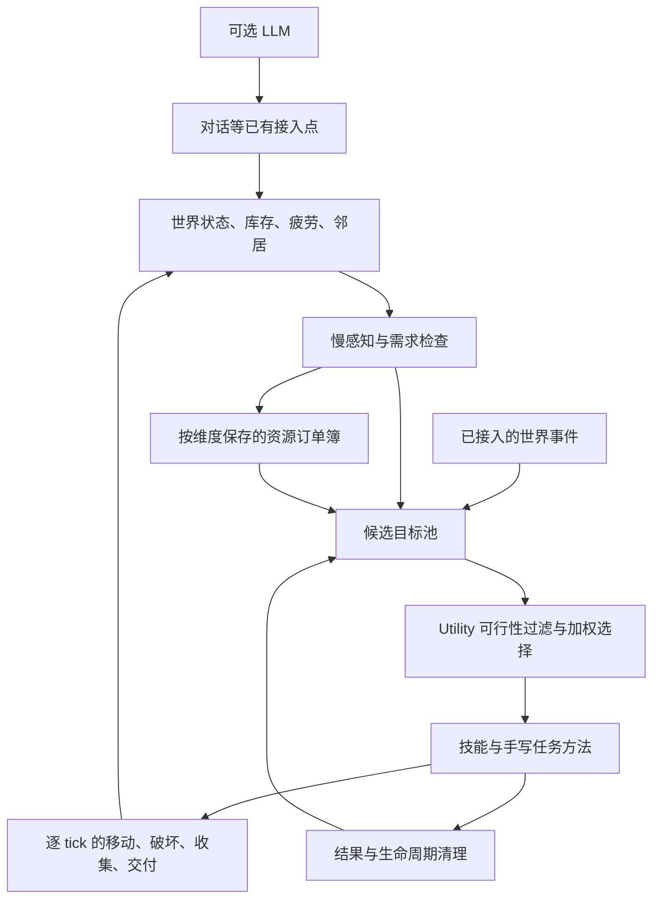
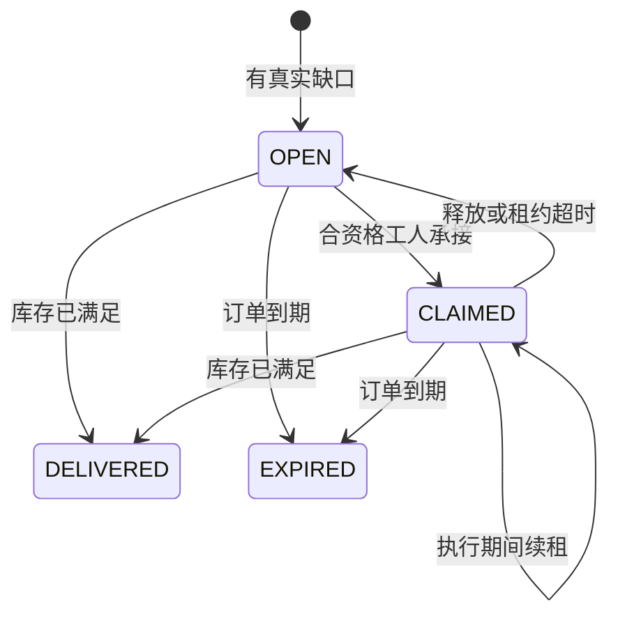

# 事件与需求驱动的大脑、资源订单（当前实现）

核对日期：2026-10-09。本文对应当前源码。旧的每日四时段计划、昼夜 routine 权重、LLM 必须在线等描述不再代表当前执行链路。

本文面向实现与维护；面试表述见 [村民 Agent 系统面试讲述](村民Agent系统面试讲述.md)。运行背景为 Minecraft 1.16.5 / Forge，核心调度和世界操作在游戏服务端线程执行。

## 架构选择

采用 Utility 选意图 + 规则任务分解 + 连续动作执行。当前资源订单采用 HTN 思路，具体实现是有限领域内的手写条件分解和状态推进；没有引入通用 HTN 搜索引擎，也没有实现 GOAP。

| 概念 | 负责什么 | 木材需求示例 |
|---|---|---|
| Utility AI | 此刻想做什么 | 比较接单、收割、聊天、闲逛、休息的价值，在可行项中加权抽样 |
| HTN（Hierarchical Task Network，分层任务网络） | 按预先定义的方法分解任务 | 供货 → 核对库存 → 准备工具 → 找树 → 走近 → 砍伐 → 收集 → 交付 |
| GOAP（Goal-Oriented Action Planning，目标导向动作规划） | 根据动作前提、效果和成本搜索路径 | 要木材 → 搜索自己砍、购买、交换等组合中当前可行的路线 |

HTN 不等于按时间执行；它规定完成任务的方法。GOAP 也不意味着自由随机行为；它仍依赖开发者正确建模动作和世界状态。两者都能在无 LLM 时运行。

当前选择 HTN 的原因是执行层仍需明确控制工具、采收结果、寻路和交付。以后可在“获取某物品”这个子任务内加入有搜索预算的 GOAP，保留相同订单和动作接口。

### 模块关系



这里的“自由”来自当前状态改变候选和权重，以及选择过程保留概率；行为仍受技能、资源、职业和世界规则约束。每个村民有独立目标与动作状态，多村民通过订单共享需求，不依赖多人轮流调用 LLM。

## 当前链路

1. 慢感知更新局部农业机会、可交谈邻居、需求、职业资格；事件可添加额外目标。
2. `GoalScheduler` 根据当前需求、机会、最近完成的任务和冷却加权抽样，没有日夜可用性门槛。
3. 正在执行的任务保持连续性；完成动作且持续了一小段时间后，可重新选择。紧急目标可抢占。
4. `processGoals` 每个服务端 tick 推进动作；旧的 `BEHAVIOR_EXECUTOR_INTERVAL_TICKS` 不再控制身体执行。`AGENT_THINK_INTERVAL` 仅控制感知和候选维护。
5. `WAITING` 释放动作和订单租约，稍后重试。`SUCCESS/FAIL/DELETE` 统一清理。不能用无限 `RUNNING` 代替等待材料。
6. 成年受管村民的原版 Brain 不再在动作空隙恢复作息；仍使用原版导航物理。幼年村民保留原版行为。

睡眠由疲劳触发，睡着后逐步恢复，不在黎明强制结束。当前需求仍是简化数值模拟，不是完整生理系统。

### 决策节奏与动作连续性

| 层次 | 当前节奏或条件 | 目的 |
|---|---|---|
| 身体执行 | 每个服务端 tick 推进 | 破坏进度、移动、收集能连续发生 |
| 感知和候选维护 | `AGENT_THINK_INTERVAL`，默认 100 ticks | 避免每 tick 全量更新环境 |
| 普通重新考虑 | 间隔至少 20 ticks；已有目标需持续至少 200 ticks，且处于无当前动作、未睡眠的边界 | 减少工作与聊天之间不断抖动 |
| 紧急目标 | 可行目标中优先级 ≥ 9 | 允许跳过普通选择；战斗另有接管路径 |
| 外部条件等待 | 普通 `WAITING` 后冷却 200 ticks；漫游目标找不到时 60 ticks | 释放执行机会，稍后再检查 |

20 TPS 时，100 ticks 约为 5 秒；服务器卡顿会使实际墙钟时间变长。这里保留的是执行频率、最小持续时间和重试冷却，不是“白天工作、晚上聊天”的作息表。

系统是**周期感知加有限事件接入**。当前不能把所有机会都描述为事件推送；`WorldEventBus` 中存在事件类型也不表示每种游戏变化都已完整接入。已有分层空间感知保留，但 Utility 并未使用其全部信息。

### Utility 如何选择

先排除已完成、已挂起、已过期或正在冷却的目标，再计算：

```text
基础分 = max(1, priority) × max(0.1, weight)
最终分 = 基础分 × 当前机会/需求修正 × 最近行为修正
普通候选的选择概率 = 最终分 / 所有可行候选最终分之和
```

这是直接按权重抽样，没有做 softmax。可行紧急目标优先，不进入普通概率竞争。

| 候选 | 当前主要修正 |
|---|---|
| 种田 | 农业机会为零时得分为零；机会越多，修正越大，有上限 |
| 睡眠 | 疲劳低于 45 时不选；达到门槛后按疲劳平方提高权重 |
| 聊天 | 必须有候选邻居且满足间隔；距离上次聊天越久越倾向聊天，性格可加权 |
| 接资源订单、交付现货交易 | 权重乘 2.5 |
| 重复制作 | 目标物品库存达到 8 时停止该常规候选 |
| 补货 | 没有零库存的必需品时不选 |
| 闲逛 | 高疲劳时降低权重 |
| 最近完成过的同类目标 | 600 ticks 内权重乘 0.3 |

例如某次实际计算后，种田、接单、聊天得分分别为 3、5、2，则普通选择概率分别为 30%、50%、20%。这是解释公式的假设数据，不是固定配置或实测统计。加权随机提高多样性，但不提供严格的无饥饿保证，也不保证村民按固定比例轮流行动。

### 技能结果与清理约定

| 结果 | 含义与处理 |
|---|---|
| `RUNNING` | 当前步骤仍在有效推进，下一 tick 继续 |
| `WAITING` | 等外部资源、订单或可达条件；释放动作与租约，目标冷却后重试 |
| `BLOCKED` | 有明确失败原因，例如缺少合格工具；尝试生成补救目标，有限重试 |
| `SUCCESS` | 当前技能目标完成；清理身体状态，按目标生命周期移除或安排再次执行 |
| `FAIL` / `DELETE` | 本轮不可继续或目标失效；退出并清理 |

`ActionLifecycle` 统一清除破坏裂纹、停止导航、释放订单租约、清理当前动作及相关状态。任务切换不能只改 `currentGoal` 而留下旧的导航或方块破坏进度。移动卡住检测依据实际位移重置计数，不能仅因路程较长就判定卡住。

**技能成功不等于订单结单。** 交付一个批次可以返回 `SUCCESS`；订单是否满足由需求方库存核对决定，仍有缺口时后续可以再次产生供货目标。

## 职业与订单

新增的 `LUMBERJACK`（伐木工）和 `MINER`（矿工）是持久化的 **agent 职业角色**，不替换原版 VillagerProfession 注册表，不新增职业贴图或专属工作站。角色与原版职业分别保存，因此不依赖原版作息和 POI 切换。

- 有合适需求时，附近无业成年村民可以自动加入资源职业；也能使用命令指定。
- 首次资源授职提供一把基础工具，沿用现有职业的启动物资约定。更换角色不能重复领工具。
- 日常 `restock` 已改成真实物资请求，不再因走到工作站就免费生成补货。首次原版职业的启动物资仍保留。
- 职业决定承接资格；Utility 决定此刻是否开始执行。
- 所有维度分别保存自己的 `WorkOrderSavedData`。
- 同一需求方、同一物品的活跃请求合并，以目标库存为完成条件。
- 单个订单只允许一个有效承接者；单个工人不能同时持有两张有效租约。
- 活动执行续租；中断释放；离线超时释放。重载保留需求，但清除执行租约，从世界与库存重建计划。
- 可以分批交付，只有需求方真实库存达到目标才结单。
- 物品插入按实际容纳数量转移，满背包不会让货物凭空消失。
- 订单过期后不继续占用工人；持续的真实库存缺口会重新产生请求。

需求来源包括经济系统的职业必需品缺口、技能失败的材料补救、获取物品任务，以及调试命令。现有经济系统也会给有解锁配方的村民创建生产目标，现货交付通过 `deliver_trade` 进入统一执行器，不再由经济 tick 直接抢导航。

当前原料订单直接交付给需求方，沿用合作供给思路；没有新增订单报价、预付款、违约罚款系统。原有现货交易仍保留其绿宝石结算规则。

### 订单数据与状态机

订单记录 `id`、需求方、物品、所需职业、目标库存、剩余缺口、到期时间、承接者和租约到期时间。目标库存采用：

```text
remaining = max(0, targetStock - requesterActualStock)
合并活跃请求时：targetStock = max(oldTargetStock, newDesiredStock)
```



枚举中还有 `CANCELLED`，当前没有完整的显式取消命令或业务流程，因此不把它画作已接通的转移。

必须维持的规则：

1. 同一需求方和物品只合并活跃订单；结单后再次消耗可以产生新订单。
2. 工人不能承接自己的请求；职业必须匹配。
3. 一张订单至多有一个有效承接者，一个工人至多持有一张有效租约。
4. 候选目标只是意向，实际执行时才 `claim`；多个村民同时看到机会不等于同时获得执行权。
5. 租约为 600 ticks，活动执行续租；订单生命周期为 24000 ticks。按 20 TPS 分别约为 30 秒、20 分钟；订单维护会处理超时。
6. 重复请求可以刷新订单到期时间。超时是恢复机制，不是交货时限或商业承诺。
7. 礼物、普通交易也可能满足库存；`DELIVERED` 在此表示需求已满足，不证明所有货都来自原承接者。

`WorkOrderBook` 是单线程的纯 Java 账本。排他性来自服务端顺序调用下的资格和所有权检查，不是分布式锁。当前库存转移与存档也不是数据库事务，不能宣称跨崩溃 exactly-once。

### 一次木材需求如何闭环

假设 A 有 2 个橡木原木，需要库存达到 10；附近 B 是伐木工：

1. A 提交 `targetStock=10`，订单缺口为 8。重复检查同一缺口合并到活跃订单，不每次新增一张。
2. B 的慢更新看到合适订单，加入 `fulfill_order` 候选。附近合资格无业村民也可以先获得资源角色。
3. Utility 选中供货，B 在执行入口承接或续租；承接失败则等待，让出身体。
4. B 检查自身库存。库存足够就配送；不足则检查工具、寻找局部暴露且可达的天然树候选。
5. 走近后逐 tick 破坏一个方块，再用收集窗口拾取真实掉落；下一次检查背包确认所得。
6. 达到本批数量后走向 A。常规批次上限为 8；资源不足但已有部分货物时也可以先交小批。
7. 靠近后按双方实际可转移数量移交。若只放入 3 个，A 库存为 5，缺口仍为 5；本次供货技能可以结束，订单仍然活跃。
8. A 实际库存达到 10 才满足需求。若期间被消耗，则按新的实际库存继续核对。

缺工具进入补救；找不到资源进入等待，之后可能通过其他闲逛行为改变位置。当前没有专门为缺矿订单规划远距离探索路线。原料采集与现有配方生产是两条相接的业务路径，尚未构成任意深度的自动产业链规划器。

## 采集方法与限制

`ResourceCatalog` 目前支持：

- 橡木、云杉、白桦、丛林、金合欢、深色橡木原木。
- 煤、铁矿石、金矿石、钻石、红石、青金石、圆石。

注意 Minecraft 1.16.5 的铁矿采收产物是铁矿石，不是新版的粗铁，也不会直接产出铁锭。后续加工使用已有制作/配方系统；完整炉子投料、燃料和出炉交互未在本次重做。

资源传感器只检查已加载的局部区域，要求方块至少有一侧暴露在空气中，并验证附近站位可达；工人可以绕到树木另一侧，不要求从当前位置直视目标。埋在地下、四周无空气的矿石不会成为候选。未发现资源时让位给其他任务，包括现有探索/闲逛，然后重试。

当前覆盖“暴露且可到达的矿石、树木可达部分”。地下掘进、修楼梯、搭脚手架采高树、整树作业、系统化补种和远距离资源运输仍需要独立任务方法。自然树判定采用附近非持久树叶的启发式，不等同于完整自然地形/玩家建筑所有权识别。

破坏动作具有工具选择、正确采收工具检查、按工具计算的破坏时长、挥手与裂纹、实际掉落、工具耐久、距离/方块变化后的进度处理，并经过 Forge 方块破坏事件。放置改用真实物品的使用上下文和 Forge 放置入口，消费背包方块。

资源搜索当前检查横向半径 10、纵向 -4 至 +5 的局部范围，过滤未加载区域；候选按距离排序，最多检查 8 个资源方块、24 条站位路径。限制查询范围和探测次数是预算控制，并不构成已验证的性能结论。

破坏使用 FakePlayer 上下文，依据玩家破坏公式和所选工具推进进度，并计算实际掉落、经验和工具损耗。不能据此断言所有药水状态、附魔或第三方模组交互都与真实玩家完全等价；这些需要游戏内验证。放置能力已接入动作层，但不等于已有完整自主选址和建筑规划能力。

## 无 LLM 与有 LLM

无 LLM 时，大脑、接单、采集、交付、关系更新和本地村民对话继续运行。接近邻居只产生聊天机会，由同一调度器决定是否聊天。

配置 LLM 后，社交走同一入口生成更丰富的内容；失败回退本地台词，异步结果回服务端线程应用。当前保留原有玩家对话、想法等接入点，没有新增完整的 LLM 战略规划器。LLM 不直接操作世界，也不能生成尚未实现的底层能力。

社交也通过统一目标选择启动，不再靠另一套自主社交 tick 竞争导航。对话回调在服务端线程应用时检查实体与距离等条件，避免请求返回后对已经失效的场景继续操作。

## 保存、恢复与扩展边界

| 数据 | 当前策略 |
|---|---|
| 资源职业、启动工具领取标记 | 随村民数据保存，换职业不重复领取 |
| 活跃订单的需求字段 | 每维度 `WorldSavedData` 保存 |
| 订单承接者和执行租约 | 不恢复；读档后重新开放承接 |
| 具体破坏进度、当前动作及技能临时计划 | 不做精确断点持久化；从当前库存与世界重建 |

恢复目标是“需求仍存在、重新判断怎么做”，不是恢复到上次执行的某条指令。世界和实体数据使用游戏的保存机制，不保证多文件原子提交。

新增采集类资源通常需要扩充 `ResourceCatalog`，定义产物、来源方块、工具和职业资格；如果操作方法不同，还需新技能方法。新增行为需要候选来源、评分条件、技能执行、完成证据及退出清理，不能只增加一句 LLM 提示词。

如果以后接入 LLM 行为提案，应先把它限制为已有技能组合，经可行性与资源检查后进入同一目标系统。此段是扩展建议，不是当前已实现的通用接口。

## 本轮改造解决的结构问题

| 原问题 | 当前处理 | 可以观察到的区别 |
|---|---|---|
| 低频思考顺带执行身体，技能计数却当成 tick | 快执行与慢感知分离 | 挖掘和工作进度按真实服务端 tick 推进 |
| 多套系统写导航，动作空隙原版 Brain 恢复作息 | 统一行为入口，成年受管村民持续接管 Brain；保留原版导航物理 | 工作不会在切换空隙被原版日程拉走 |
| 缺材料却无限返回执行中 | 区分等待、受阻、失败与成功 | 等不到资源时能让出行动机会 |
| 补救目标长期占据紧急优先级 | 去掉永久恢复提权，使用冷却与重试 | 修复一次问题后不会一直压过日常行为 |
| 技能完成标志与返回值不一致 | 统一完成结果并兼容旧完成标志 | 减少重复制作、目标难以退出 |
| 经济系统直接驱动交易双方移动 | 供应方执行 `deliver_trade` 目标 | 交易通过同一身体执行入口竞争 |

例如旧路径若每 100 ticks 调一次技能，技能每次只给工作计数加 1，计数 200 才结束，那么 20 TPS 下会从预期 10 秒变成约 1000 秒。这是调用频率与计数单位不一致的推导，不是运行时实测成绩。

## 源码入口

以下链接相对于本文；优先按执行链阅读，旧文档中的方案不自动代表实现。

| 职责 | 入口 |
|---|---|
| 主循环与目标结果处理 | [VillagerAgentManager](../src/main/java/com/github/AaronAA0721/villageragent/ai/VillagerAgentManager.java) |
| 概率选择和条件权重 | [GoalScheduler](../src/main/java/com/github/AaronAA0721/villageragent/ai/GoalScheduler.java) |
| 常规候选与机会感知 | [RoutineScheduler](../src/main/java/com/github/AaronAA0721/villageragent/ai/RoutineScheduler.java)、[OpportunitySensor](../src/main/java/com/github/AaronAA0721/villageragent/ai/OpportunitySensor.java) |
| 动作退出与释放 | [ActionLifecycle](../src/main/java/com/github/AaronAA0721/villageragent/ai/ActionLifecycle.java) |
| 订单状态与保存 | [WorkOrderBook](../src/main/java/com/github/AaronAA0721/villageragent/ai/work/WorkOrderBook.java)、[WorkOrderSavedData](../src/main/java/com/github/AaronAA0721/villageragent/ai/work/WorkOrderSavedData.java) |
| 需求接入与职业授予 | [ResourceWorkSystem](../src/main/java/com/github/AaronAA0721/villageragent/ai/work/ResourceWorkSystem.java) |
| 采集与交付任务方法 | [ResourceWorkSkill](../src/main/java/com/github/AaronAA0721/villageragent/ai/behavior/ResourceWorkSkill.java) |
| 资源范围与感知 | [ResourceCatalog](../src/main/java/com/github/AaronAA0721/villageragent/ai/work/ResourceCatalog.java)、[ResourceSensor](../src/main/java/com/github/AaronAA0721/villageragent/ai/work/ResourceSensor.java) |
| 世界操作与数量转移 | [BlockInteractionAction](../src/main/java/com/github/AaronAA0721/villageragent/ai/BlockInteractionAction.java)、[InventoryTransfer](../src/main/java/com/github/AaronAA0721/villageragent/ai/InventoryTransfer.java) |
| 工具缺失等补救 | [FailureRecoveryPlanner](../src/main/java/com/github/AaronAA0721/villageragent/ai/FailureRecoveryPlanner.java) |
| 订单规则自动检查 | [WorkOrderBookChecks](../src/test/java/com/github/AaronAA0721/villageragent/ai/work/WorkOrderBookChecks.java) |

## 调试与验收

命令作用于距离执行者最近的受管村民：

```text
/va occupation lumberjack
/va occupation miner
/va occupation none
/va request minecraft:oak_log 8
/va request minecraft:iron_ore 4
/va orders
```

`request` 表示让这个村民请求新增数量的物资；自己不能接自己的外部订单。先在需求方附近发请求，再在另一村民附近设定职业，或者等待无业村民自动响应。需要开启 AI、世界交互和经济系统。资源职业首次授予会给一把基础工具，钻石/金矿等仍需要合格铁镐。

建议在测试存档做以下场景：

1. 不配 LLM，两个成年村民、天然树和可达露天矿。观察接单、逐块破坏、收集、走回交付；对照双方背包与 `/va orders`。
2. 两个工人竞争一张订单，确认只有一人有效承接；工人卸载或受惊后另一人能接续。
3. 矿工拿不合适的镐，确认不凭空产矿，而是请求工具或等待。
4. 需求方背包满、供应方只有部分货，确认数量守恒且未错误结单。
5. 任务期间移除目标矿石、阻断路径、让双方拉开距离，确认超时/等待后能做别的事。
6. 保存退出后重进，需求和职业仍在，旧执行租约不造成永久占用。
7. 疲劳高时白天可休息，夜里若没有休息需要可以继续工作；种田与聊天都无需 LLM。

自动检查入口：`gradlew workOrderChecks` 或 `gradlew check`。纯 Java 订单检查覆盖请求去重、独占承接、租约续期/失效、部分交付、外部库存满足、再需求和维度账本隔离。编译和这些检查不能代替 Minecraft 场景验收。

最近一次代码改造验证：`check build --offline --console=plain` 通过；其中订单规则检查包含 21 条断言。它们不是 21 项游戏集成测试。上述手工场景尚未完成游戏内验证，也没有村民规模、TPS、行为分布或 LLM 时延的实测数据。本次文档整理未修改运行代码。
