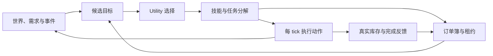

# 村民 Agent 系统：面试讲述与追问准备

核对日期：2026-10-09。技术细节以 [事件驱动大脑与资源订单](事件驱动大脑与资源订单.md) 和当前源码为准。

本文提供可练习的讲述模板。第一人称的职责范围请按自己的实际参与情况调整；已有系统能力、此次改造和后续设想要分开讲。系统已通过编译与订单规则检查，尚未完成 Minecraft 游戏内场景验收，不能将预期效果表述为已测结果。

## 1. 先明确项目定位

**一句话：在 Minecraft 服务端实现一个不依赖 LLM 的村民行为与资源协作系统，通过需求、环境机会和概率选择产生行为，可选 LLM 丰富交互。**

可以强调三个问题：

1. 村民现在想做什么：由当前需求、机会和 Utility 权重决定。
2. 村民具体怎么做：由手写任务方法和逐 tick 的动作执行器推进。
3. 村民之间怎么合作：由资源需求订单、职业资格、租约和真实库存交付连接。

这里的 Agent 指有状态、可感知和行动的游戏智能体。多个村民共享订单簿并不等于分布式微服务或多 LLM 对话框架。

## 2. 30 秒版本

> 这个项目是 Minecraft 的村民智能体系统。我关注的是让村民根据当前情况自主选择工作、聊天和休息，而不是依赖固定作息或每次询问大模型。架构上用 Utility 做加权任务选择，用手写任务分解完成具体工作，再由执行层逐 tick 操作世界。村民缺少木材或矿物时可以发布订单，伐木工、矿工承接后实际采集并交付。LLM 是可选增强，规则行为链路可以离线运行。

## 3. 约 90 秒版本

> 项目的目标是让村民具有持续、可解释的自主行为，并且在没有 LLM 时也能正常生活和协作。
>
> 我把问题分成三层。第一层用环境机会、疲劳、库存和邻居生成候选，再通过 Utility 加权选择，所以种田、接单、聊天之间会随状态变化。第二层使用 HTN 思路的手写任务分解，例如供货可以分为检查库存、准备工具、找资源、采集和交付。第三层每个服务端 tick 推进行走和方块破坏，避免低频决策拖慢动作。
>
> 多村民协作使用按维度保存的订单簿。同一个需求方的同种物品请求会合并，工人执行时领取租约，中断或超时后可以重新承接。完成判断依据需求方的实际库存，支持部分交付，不会因为走到对方面前就当作完成。
>
> 这次改造的重点是打通规则闭环、统一动作控制以及明确失败和恢复，而不是让 LLM 控制每一步。当前通过了构建和订单规则检查；完整地下采矿、通用规划和游戏内规模测试仍是后续工作。

## 4. 3～5 分钟展开顺序

### 4.1 背景与问题

从用户可见的问题开始：村民长时间停留在一种行为，任务完成后难以退出，缺材料时不做其他事，多个子系统可能同时控制移动。

然后给出工程原因：决策和动作执行频率混在一起；技能返回值与完成标记不一致；等待外部资源没有独立语义；原版 Brain、社交、经济路径与自定义任务争用身体。

不要笼统归因于“模型不够聪明”。这些首先是调度、状态与执行生命周期问题。

### 4.2 架构白板

画图时补充：感知是低频更新，动作是高频推进；事件只接入了一部分，不能把整套系统说成纯事件驱动。LLM 画在侧边的对话等接入点，不画成所有动作的必经节点。

### 4.3 用木材订单讲完整闭环

> A 有 2 个原木，希望库存达到 10，于是产生缺口为 8 的订单。B 是伐木工，看到订单后加入供货候选，但不立即霸占它。调度器选中供货时，B 才申请租约。随后先检查库存和工具，找到附近暴露且可达的树木，走近并按工具速度逐 tick 砍伐，收集真实掉落，再走回 A 交付。如果 A 只能接收 3 个，就只转移 3 个，订单还剩 5 个。只有 A 的真实库存满足目标才结单。

接着讲异常：缺工具生成补救；没资源则等待并释放机会；工人被打断释放租约；重启保存需求，但不恢复旧动作和租约，重新根据世界状态执行。

### 4.4 设计取舍与证据

说明为何保留规则基础：世界操作需要可验证的前提、时间和完成结果，LLM 断网不能影响基本行为。

说明为何没有直接上通用规划器：当前操作范围有限，先把工具、可达性、库存和失败路径落实。手写方法更容易定位执行问题，代价是新复杂能力需要开发者继续写方法。

最后说已验证范围：构建通过，纯 Java 订单检查包含 21 条断言；还没有游戏内完整验收或性能基准。不要把预算限制直接说成 TPS 提升。

## 5. HTN、GOAP、Utility 的区别

| 维度 | Utility AI | HTN | GOAP |
|---|---|---|---|
| 核心问题 | 现在优先做什么 | 一个任务如何分解 | 哪些动作组合能够达到目标 |
| 主要输入 | 候选、需求、机会、权重 | 任务、可选方法、适用条件 | 世界状态、目标、动作前提/效果/成本 |
| 主要输出 | 一个意图或候选目标 | 分解后的子任务和原子动作 | 搜索得到的动作计划 |
| 开发者主要工作 | 设计评分与选择约束 | 编写领域分解方法 | 建模状态、动作与搜索策略 |
| 木材例子 | 决定此刻是否供货 | 供货分为采集、收集、交付 | 在砍树、交易等路线之间搜索 |
| 当前项目 | 已有加权抽样 | 使用分层分解思想，手写条件和状态推进 | 尚未实现 |

**可以直接回答：**

> HTN 是 Hierarchical Task Network，分层任务网络，它通过预先定义的方法把复杂任务逐步分解。GOAP 是 Goal-Oriented Action Planning，目标导向动作规划，它根据动作前提、效果和成本搜索到达目标的行动序列。两者都能不依赖 LLM，也都不等于按时间表工作。我这里用 Utility 负责选意图，用 HTN 思路组织有限领域的执行方法，没有实现通用 HTN 搜索器或 GOAP。

手写状态推进也可以具有状态机特征，不需要为了名称强行否认。与行为树或 FSM 相比，本项目选择把“目标价值”和“具体执行”分开；其他技术同样可以实现自主行为，并非天然不适合。

## 6. 一个适合深入讲的排障案例

### 场景：村民一直显示工作，却迟迟没有结果

**现象：** 上层目标存在，技能也不断执行，但工作进度极慢，看起来像大脑卡死。

**定位：** 检查主循环调用链，再核对技能计数的单位。旧路径将执行放在低频思考更新中，假设每 100 ticks 调一次，而技能每次只给计数加 1，却按 200 ticks 的阈值结束。

**推导：** 20 TPS 下预期 200 ticks 是 10 秒；如果每 100 ticks 才增加一次，那么要 20000 ticks，约 1000 秒。这是代码时序推导，不是实测性能提升。

**修改：** 将身体执行搬到服务端逐 tick 路径，慢循环只负责感知与候选维护。同时规范技能返回值，明确等待和完成，让统一退出流程负责释放导航、裂纹和租约。

**验证与边界：** 构建检查确保调用路径可编译；订单断言检查协作规则。要证明游戏表现，还需要实际记录开始时间、动作进度与完成时间。不要说“已提升 100 倍”：理论调用频率变化不等于端到端性能基准。

## 7. 常见追问与回答要点

### 为什么要概率选择，直接选最高分不行吗？

最高分容易让优势行为一直胜出。这里在正分候选间按权重抽样，再结合近期行为降权和状态门槛，保留行为变化。但随机不是正确性的来源：无工具、无目标等条件仍要在执行前检查。紧急目标有单独优先规则。

### 会不会刚开始砍树就跑去聊天？

普通重新选择受到最小目标持续时间和动作边界限制，不是在每 tick 强制抽一个新目标。已有破坏动作会连续推进；紧急情况仍能接管。退出由统一生命周期清理，避免残留导航和裂纹。当前没有为所有行为设计严格的公平调度保证。

### 这是不是每过几秒随机做一件事？

不是无条件随机。候选由机会和需求生成，评分随疲劳、农业机会、社交间隔、库存和最近行为变化。固定周期只是检查频率，最后选择还必须通过可行性门槛。

### 为什么需要租约，游戏不是单线程吗？

单线程避免同一时刻并发写入，但不能解决工人离开、卸载或被打断后一直占着任务。租约表达有期限的工作所有权，活动执行续租，异常中断后可回收。它不是分布式锁，也没有跨进程一致性协议。

### 两个工人同时看到一张订单怎么办？

看到订单只会生成候选，执行入口才承接。账本检查订单的有效持有人和工人已有租约，在服务端线程顺序处理请求。后到的工人承接失败，进入等待，不获得第二份执行权。

### 怎么避免重复订单？

按需求方和物品合并活跃请求，目标库存取较大值，剩余缺口按实际库存重算。结单后再次消耗可以产生新请求。这是活跃请求去重，不是永久幂等键或 exactly-once 执行。

### 为什么用目标库存，不直接记已经送了多少？

需求也可能被普通交易或赠送满足，期间还可能消耗物品。目标库存让账本以实际世界状态为准。但这是一种补库存语义，不适合直接当作有付款义务的商业合同；后者需要单独的履约数量和结算模型。

### 怎么防止满背包时丢物品？

新交付路径先按目标容量确定实际插入数量，再从来源扣除相同数量；拾取也保留未容纳的掉落。部分交付可以结束一次技能，但不满足目标库存就不关闭订单。这个结论限定在对应路径，不代表整个模组具备事务性物品系统。

### 重启后从哪里继续？

持久化资源职业和活跃需求，读档时不恢复旧租约与动作指针。重新检查库存、目标与可达性，生成新的执行过程。这样降低恢复过期世界引用的风险，但不保证跨崩溃的物品操作原子性。

### 没有 LLM，村民怎么知道砍树和挖矿？

开发者提供资源目录、职业资格、工具要求和任务方法，村民根据订单与状态选用这些能力。它不需要现场推理出 Minecraft 规则。LLM 可以丰富表达和已有接入点的内容，但不能替代尚未实现的动作接口。

### LLM 现在到底负责什么？

当前保留玩家对话、想法等已有接入点，村民社交可以使用模型生成文本；失败回退本地台词。规则大脑、采集订单和交付不依赖网络。完整的 LLM 战略规划或通用行为提案接口尚未新增，不应把未来方向当成现状。

### 方块破坏为什么不是直接删掉方块？

执行层会选择工具、检查可达条件、逐 tick 推进破坏进度，并处理裂纹、真实掉落、耐久和 Forge 事件。它借助 FakePlayer 上下文使用玩家相关规则。当前不能承诺每一种状态效果或其他模组联动都与真实玩家完全一致。

### 矿工能自动挖到地下钻石吗？

目前只针对局部暴露且可达的资源，不透视被完整包裹的地下矿石，也没有自动掘进、修楼梯或完整洞穴探索。石镐不能凭空变成可采钻石的工具。要支持深层采矿，需要扩充探索、路径改造、风险判断和工具供应方法。

### 如何控制性能，能带多少村民？

已采用快慢循环分离、有限范围扫描和路径候选预算，但没有规模压测，不能给出可靠村民数量。下一步应按村民数、订单数和资源密度构造场景，测服务端 tick 耗时、扫描与寻路耗时、活跃订单量和等待时长分布。订单簿线性遍历等路径也需要据此判断是否加索引。

### 以后什么时候引入 GOAP？

当“获取某物品”有多条可替代路线，且手写分支明显膨胀时，可以在这一子任务引入有限搜索预算的 GOAP。需要先给技能建模前提、效果和成本，并处理世界变化导致的计划失效；订单、库存与底层动作接口可以继续复用。这是后续方案。

## 8. 可放入简历的描述模板

以下仅保留自己实际负责且能现场解释的内容：

- 参与 Minecraft 村民 Agent 行为系统改造，将低频环境感知与逐 tick 动作执行分离，以需求和机会驱动的 Utility 选择组织工作、社交和休息。
- 实现伐木工、矿工资源供给流程，通过目标库存订单、独占租约、部分交付和统一动作清理连接多村民协作；基础链路无需 LLM。
- 将订单规则抽离为纯 Java 模块，编写包含 21 条断言的自动检查，覆盖活跃请求去重、租约恢复和库存满足等约束，并接入构建检查。

如果没有亲自承担全部实现，将“实现”改为实际职责，例如“参与设计”“负责验证”或“阅读并复现”。不要使用未经测量的成功率、性能提升、在线规模或生产应用数据。

## 9. 演示与证据准备

### 最小演示

1. 使用测试存档，开启 AI、世界交互和经济系统，不配置 LLM。
2. 准备两位受管成年村民和附近可达的天然树。
3. 靠近需求方执行 `/va request minecraft:oak_log 8`；靠近另一位执行 `/va occupation lumberjack`。
4. 用 `/va orders` 和双方背包观察请求、承接、砍伐、收集与交付。命令选择最近村民，注意站位。
5. 再演示一种异常：让需求方背包满，或打断工人，观察实际数量与订单恢复。

首次资源授职会提供基础工具，要主动解释这是启动物资，不要把演示说成从零建立完整经济。游戏内验证完成前，把以上内容称为验收步骤，不称为已经通过的演示结果。

### 已有证据与缺口

| 可以出示 | 能说明什么 | 不能推出什么 |
|---|---|---|
| `GoalScheduler` 源码 | 条件权重、抽样与紧急优先逻辑 | 长期行为分布已符合设计 |
| `ResourceWorkSkill` 与动作层源码 | 供货方法、工具检查和执行过程 | 所有游戏地形都可完成采集 |
| `WorkOrderBookChecks` 的 21 条断言 | 已覆盖的账本规则在检查输入下成立 | 21 项游戏集成测试或所有异常均正确 |
| 最近一次 `check build` 通过 | 代码构建及所接入检查通过 | 游戏体验、TPS 或规模已经验收 |

### 面试前自测

- 能否不用术语，用 A 缺木材、B 去供货的例子解释整个流程？
- 能否解释为什么需要“候选”和“承接”两个阶段？
- 能否说明一次技能 `SUCCESS` 与订单 `DELIVERED` 的区别？
- 能否指出快慢循环、动作清理和库存核对的源码位置？
- 能否说清无 LLM、有 LLM 和未来规划各自的范围？
- 能否坦诚列出未实现能力，并提出可验证的下一步，而不编造结果？
