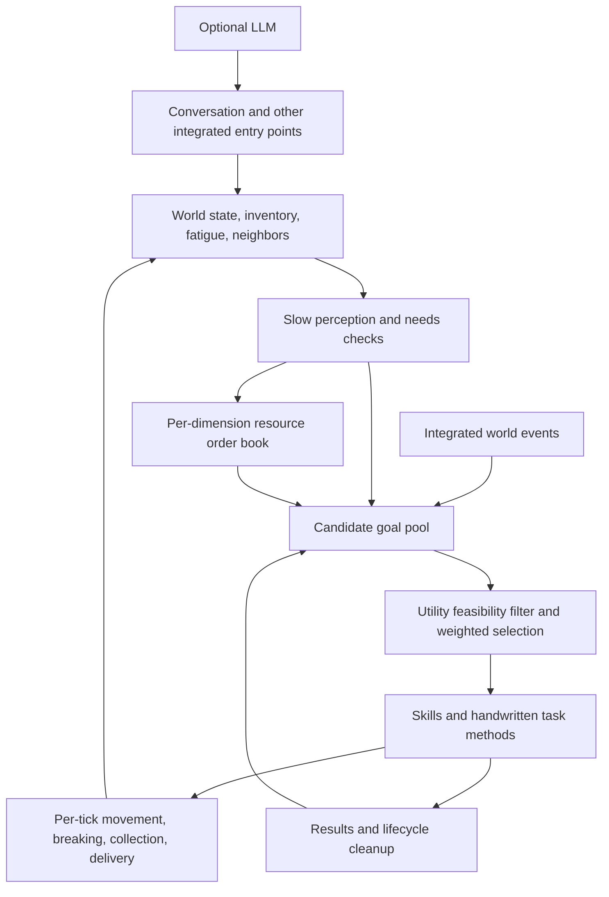
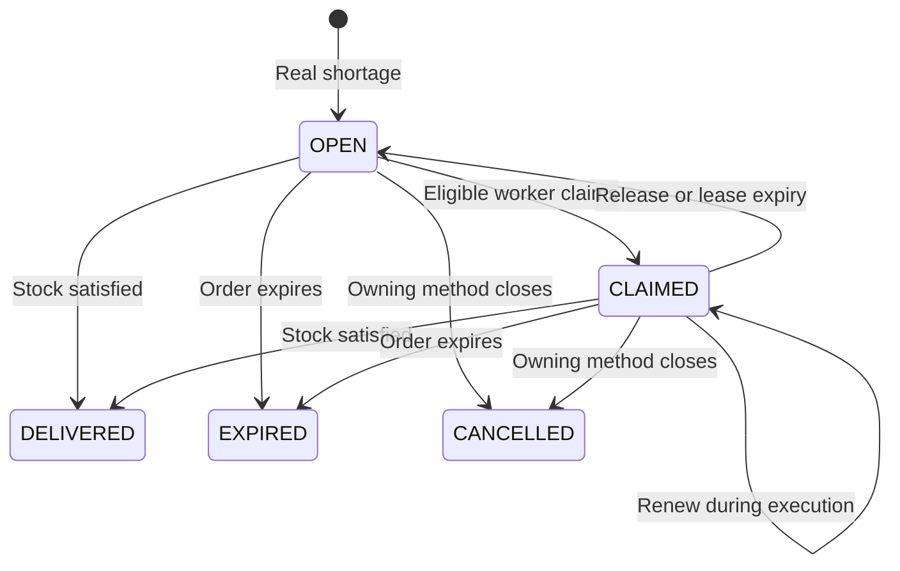

# Event- and need-driven brain and resource orders

Reviewed: 2026-10-27. This document describes the current workspace's main loop, goal exits, and resource orders.

This is implementation and maintenance documentation. See [Project walkthrough](project_walkthrough.md) for interview presentation. The runtime is Minecraft 1.16.5 / Forge; core scheduling and world operations run on the game server thread.

## Architecture

The system combines Utility intent selection, rule-based task decomposition, and continuous action execution. Item acquisition uses registered output-matched methods, recursive prerequisites, and cost/stall scoring. Resource-order execution uses handwritten supply steps and shares extraction with personal acquisition. This is a bounded HTN-style implementation, not a general planner over arbitrary world-state effects or a GOAP search engine. See [Task methods](task_methods.md).

| Concept | Responsibility | Timber example |
|---|---|---|
| Utility AI | Choose what to do now | Compare supplying orders, harvesting, chatting, wandering, and resting; sample feasible options by weight |
| Implemented task methods | Discover item producers, choose one method, and execute prerequisites | Acquire logs → choose extraction, purchase or cooperative supply; extraction may first acquire an axe |
| GOAP (comparison only; not implemented) | Search arbitrary modeled world states through action effects | A general action-state search would need additional state/effect modeling |

HTN defines methods for completing tasks, not a time schedule. GOAP still depends on correctly modeled actions and world state, rather than unrestricted random behavior. Both can run without an LLM. Task methods explicitly control tools, harvest results, navigation, and delivery; skill method bodies determine coverage.

### Module relationships



Behavioral freedom comes from state-dependent candidates/weights and probabilistic selection, within skill, resource, profession, and world constraints. Each villager has independent goal/action state; orders share demand without requiring villagers to take turns calling an LLM.

## Current pipeline

1. Slow perception updates local farming opportunities, remembered fields, conversation neighbors, needs, and profession eligibility. Events can add goals.
2. `GoalScheduler` samples using current needs, opportunities, recently completed tasks, and cooldowns. Nighttime rest takes precedence over ordinary work; other behavior remains state-scored.
3. Active tasks retain continuity. After completing an action and running for a minimum period, selection may repeat. Urgent goals can preempt; positive-score executable non-wander goals can interrupt wandering.
4. `processGoals` advances actions every server tick independently of `BEHAVIOR_EXECUTOR_INTERVAL_TICKS`. `AGENT_THINK_INTERVAL` controls only perception/candidate maintenance.
5. `WAITING` releases actions and order leases for a later retry. `SUCCESS/FAIL/DELETE` share cleanup; `GoalExitPolicy` determines retention/retry. Waiting for materials must not become endless `RUNNING`.
6. The custom Brain continuously controls managed adults using vanilla navigation physics. Children retain vanilla behavior.

Rest becomes eligible at fatigue 40: low daytime weight yields to important work, while nighttime rest has high weight without preempting. Fatigue 80 permits interruption of ordinary work. Sleep normally ends at fatigue zero, not automatically at dawn; daytime fatigue can also cause rest. Sleeping adds no waking fatigue. Needs remain a simplified numeric model.

### Decision timing and action continuity

| Layer | Current interval or condition | Purpose |
|---|---|---|
| Body execution | Every server tick | Continuous breaking, movement, and collection |
| Perception/candidates | `AGENT_THINK_INTERVAL`, default 100 ticks | Avoid full environmental updates every tick |
| Ordinary reconsideration | At least 20 ticks between checks; existing goal active at least 200 ticks, with no current action and not sleeping | Reduce oscillation between work and conversation |
| Urgent goals | Feasible priority ≥ 9 | Bypass ordinary selection; combat has separate control |
| External waiting | `WAITING` causes a 200-tick exit-policy cooldown | Yield execution and check later |

At 20 TPS, 100 ticks is about five seconds; server lag increases wall-clock time. These are execution frequencies, minimum durations, and retry cooldowns, not daily activity slots.

The agent registry is shared, but thought timestamps and attack cooldowns belong to individual villagers. Each world tick resolves a villager in that dimension before advancing its timestamp or cooldown. This prevents another dimension from consuming its update or decrementing its cooldown again. Slow updates reuse the resolved entity, observe workbenches, maintain goals, and unlock recipe dependencies. Trade demonstrations retain their normal-scheduling/combat exclusions.

The system combines periodic perception with limited event integration. Not every opportunity is pushed as an event, and enum presence does not prove complete game-event wiring. Layered spatial perception remains available, but Utility does not use all of its information.

### Work priorities

Priority floors are 8 for finding job sites and stock delivery; 7 for farming, crafting, and resource orders; and 6 for restocking, acquiring items, gathering, and trading. Executor maintenance raises older saved goals to these floors, preserving existing urgent priorities 9–10. Socializing is 3; ordinary wander is 2 and only a fallback. At fatigue 80, rest precedes ordinary work and can interrupt farming, while urgent 9–10 goals retain precedence. Priorities contribute to Utility weighting rather than strict integer ordering; ordinary work does not mutually preempt, and the urgent threshold remains 9.

### Utility selection

Filter completed, suspended, expired, and cooling-down goals, then calculate:

```text
baseScore = max(1, priority) × max(0.1, weight)
finalScore = baseScore × currentOpportunityOrNeedModifier × recentBehaviorModifier
ordinarySelectionProbability = finalScore / sumOfFeasibleFinalScores
```

Sampling uses weights directly, without softmax. Feasible urgent goals bypass ordinary probability competition. Ordinary wander participates only when no other positive-score goal has a handler.

| Candidate | Main current modifiers |
|---|---|
| Farming | Local opportunities plus revisitable farmland anchors; absent local maintenance, travel to remembered fields and recheck on arrival. See [Spatial perception](vision_module_implementation.md) |
| Sleep | Eligible at fatigue 40: very low daytime/high nighttime weight; preemption of ordinary work only at 80 |
| Conversation | Requires a neighbor and elapsed interval; longer since last conversation increases preference, with personality weighting |
| Resource orders and stock deliveries | Weight × 2.5 |
| Repeated crafting | Stop the routine candidate when target stock reaches 8 |
| Restock | Not selected unless an essential item has zero stock |
| Wander | Fallback without another positive executable goal; lower weight at high fatigue |
| Recently completed same-type goals | Weight × 0.3 for 600 ticks |

Hypothetical farming/order/chat scores of 3/5/2 give 30%/50%/20% selection probabilities. These illustrate the formula, not configuration or measurements. Weighted randomness increases variety but guarantees neither starvation freedom nor fixed action proportions.

### Skill results and cleanup

| Result | Meaning and handling |
|---|---|
| `RUNNING` | Current step is progressing; continue next tick |
| `WAITING` | Await external resources, orders, or reachability; release action/lease and retry after cooldown |
| `BLOCKED` | Explicit failure such as a missing suitable tool; try recovery goals with bounded retries |
| `SUCCESS` | Current skill goal completed; clean body state and remove/reschedule according to lifecycle |
| `FAIL` / `DELETE` | Attempt cannot continue or goal is invalid; exit and clean up |

`ActionLifecycle` clears cracks, stops navigation, releases leases, and clears current action/related state. Switching only `currentGoal` while leaving old navigation or breaking progress is invalid. Stuck detection resets on actual displacement; a long route alone is not a stall.

Skill success and order completion are distinct. A batch delivery may return `SUCCESS` while requester inventory still leaves an order shortage and later supply goals remain possible.

### Goal exits and retries

`GoalExitPolicy.retain` is authoritative:

- `SUCCESS` resets failures. One-shot goals are removed; repeatable goals remain, clear target positions/farming mode, and cool down for at least 100 ticks.
- `WAITING` retains the goal with a 200-tick cooldown and unchanged failure count.
- `BLOCKED(MISSING_ITEM)` retains supply dependencies and cools down for 200 ticks without spending a failure attempt. Other `BLOCKED/FAIL` results accumulate failures and remove the goal at three. UNREACHABLE retries after 200 ticks; other failures wait at least 200 ticks or the goal's existing cooldown.
- `DELETE` removes immediately. `RoutineScheduler` waits at least 1200 ticks before reseeding repeatable goals removed for non-success results.
- Non-sleep execution times out after 2400 ticks without applicable progress. Continuous farming refreshes this timer after real successful operations, and child-action gaps do not trigger ordinary switching. Navigation failures also enter the exit protocol.

`REPEATABLE` defines regeneration and post-completion cooldown. Skills are singletons; per-villager state belongs in `VillagerAgentData`, `BrainRuntime`, or action objects. Actual NBT fields determine persistence.

## Professions and orders

`LUMBERJACK` and `MINER` are cached resource-order roles synchronized from the registered `villageragent:lumberjack` and `villageragent:miner` professions. They claim the carpenter table and miner workbench through the normal POI path. See [Workstations](workstations.md). Older independent role data is reconciled to the actual entity profession on update.

- Nearby unemployed adults obtain these professions by claiming their workstations. Orders do not assign jobs. The occupation command sets the actual profession and clears its previous job-site reservation.
- First resource assignment provides one basic tool under the starter-supply convention; switching roles cannot grant it again.
- Daily `restock` delegates shortages to acquisition, whose method executor compares crafting, paid product purchases and cooperative supply using remaining cost and stall penalties. See [Task methods](task_methods.md). First vanilla profession assignment provides starter supplies.
- Profession controls claim eligibility; Utility controls when execution starts.
- Each dimension has its own `WorkOrderSavedData`.
- Active requests merge only when requester, item and `ownerAttempt` all match. Ordinary requests have a null owner; separate method attempts keep independent demand.
- One valid claimant per order and one valid lease per worker.
- Active work renews leases; interruption releases them; absence expires them. Reload preserves active ordinary demand but excludes method-owned orders, clears leases, and rebuilds execution from world/inventory state.
- Partial batches are allowed; only actual requester stock reaching the target closes the order.
- Transfers use actual capacity, preserving items when inventories are full.
- Expired orders stop occupying workers; persistent real shortages generate new requests.

Demand comes from profession essentials in the economy system, failure recovery, item-acquisition tasks, and debug commands. The economy creates production goals for villagers with unlocked recipes; stock trades reserve both participants and enter the unified executor as paired `meet_trade` roots after natural task boundaries. See [Trade and supplies](capabilities_crafting_and_economy.md#trade-and-supplies) for the readiness barrier and per-market scope.

Raw-material orders directly deliver cooperative supply to requesters. Orders cover demand/supply without quotes, advance payments, or breach penalties; stock trading settles in emeralds.

### Order data and state machine

An order records id, requester, item, required profession, target stock, remaining shortage, expiry, claimant, lease expiry, and optional `ownerAttempt`. Request bridges cap desired stock at 256.

```text
remaining = max(0, targetStock - requesterActualStock)
When merging active requests: targetStock = max(oldTargetStock, newDesiredStock)
```



`cancelOwned` is wired into method cleanup: it cancels active orders for that attempt and releases their workers. There is no separate user-facing order-cancellation command.

Required invariants:

1. Only active orders with the same requester/item/owner merge; consumption after completion can create a new order.
2. Workers cannot claim their own requests and must match the profession.
3. At most one valid claimant per order and one valid lease per worker.
4. A candidate expresses intent; execution ownership requires a claim. Multiple villagers observing an opportunity does not grant them simultaneous execution rights.
5. Worker leases last 600 ticks and renew during execution. Ordinary demand expires after 24000 ticks; method-owned demand expires after 600 ticks and must be refreshed by its requester. Worker renewal does not refresh demand expiry. At 20 TPS these durations are 30 seconds and 20 minutes.
6. Repeated requests can refresh expiry. Timeouts provide recovery, not delivery deadlines or commercial promises.
7. Gifts and ordinary trades can satisfy stock too. `DELIVERED` means demand is satisfied, not that every item came from the original claimant.

`WorkOrderBook` is a single-threaded pure Java ledger. Sequential server eligibility/ownership checks provide exclusivity, not distributed locks. Inventory transfer and persistence are not database transactions and provide no cross-crash exactly-once guarantee.

### Closing a timber request

Suppose A has two oak logs and wants ten; nearby B is a lumberjack:

1. A requests `targetStock=10`, leaving eight. Repeated shortage checks merge into the active order.
2. B's slow update sees the order and adds a `fulfill_order` candidate. The worker must already have the appropriate profession and extraction skill.
3. Candidate allocation reserves the order before creating the supply goal. When Utility selects supply, B renews or reacquires the lease at execution entry. If another worker owns it, B removes the stale goal and yields.
4. B checks inventory: enough stock means delivery; otherwise check tools and find locally exposed reachable natural-tree candidates.
5. Approach and break one block over ticks, collect real drops during a collection window, then inspect inventory to confirm the yield.
6. Travel to A after reaching the batch amount. Normal batches are capped at eight; limited resources can result in a smaller partial batch.
7. Transfer only what both inventories permit. If three fit, A has five and still lacks five. The supply skill can finish while the order remains active.
8. Demand is satisfied only at actual stock ten; consumption during execution changes the next stock check.

Missing tools trigger recovery; missing resources trigger waiting and potentially later movement through wandering. There is no dedicated long-distance exploration route for missing-ore orders. Raw gathering and recipe production connect, but do not form an arbitrary-depth industrial planner.

## Gathering methods and limits

`ResourceCatalog` supports oak, spruce, birch, jungle, acacia, and dark-oak logs; coal, iron ore, gold ore, diamonds, redstone, lapis lazuli, and cobblestone. It also registers mature wheat, carrot, potato and beetroot crops for personal acquisition. Crop entries have no resource-order profession and cannot create cooperative resource orders.

In Minecraft 1.16.5, iron mining yields iron ore. Ingot processing uses crafting/recipe systems; recipe resolution and material conversion do not establish complete furnace input, fuel, and output interaction, which needs separate verification.

Sensors inspect only local loaded areas, require at least one air-exposed face, and validate reachable nearby standing positions. Workers may approach from another side of a tree; direct sight from the current position is unnecessary. Fully buried ore is excluded. No resource yields execution to other tasks, including exploration/wandering, before retrying.

Coverage is exposed reachable ore and reachable tree portions. Tunneling, stairs, high-tree scaffolding, whole-tree work, systematic replanting, and long-distance transport need separate methods. Natural-tree detection uses nearby nonpersistent leaves as a heuristic, not full terrain/player-building ownership recognition.

Breaking selects tools, checks harvest suitability, computes duration, displays swings/cracks, creates actual drops, consumes durability, handles changed distance/blocks, and passes through Forge break events. Placement uses real item-use context and Forge placement, consuming inventory blocks.

Search spans horizontal radius 10 and vertical -4 to +5, excludes unloaded regions, sorts by distance, and checks at most eight resource blocks and 24 standing paths. These are budgets, not measured performance evidence.

FakePlayer breaking uses player formulas and the selected tool for progress, drops, XP, and wear. Full equivalence for potion effects, enchantments, and third-party mods requires in-game tests. Action-layer placement does not imply autonomous site selection or complete building planning.

## With and without an LLM

Without an LLM, the brain, order claims, gathering, delivery, relationship updates, and local villager dialogue continue. Nearby neighbors create conversation opportunities selected by the same scheduler.

With an LLM, the same social entry point generates richer content, falls back to local lines on failure, and applies asynchronous results on the server thread. See [LLM and world interaction](llm_and_world_interaction.md) for player chat and thoughts. Autonomous rule goals come from candidate maintenance, needs, and integrated events. LLM output neither directly manipulates the world nor creates unimplemented capabilities.

Server-thread conversation callbacks check entities, distance, and context before applying returned results.

## Persistence, recovery, and extension boundaries

| Data | Current policy |
|---|---|
| Resource role and starter-tool receipt flag | Saved with villager data; switching roles does not grant tools again |
| Active ordinary-order demand fields | Per-dimension `WorldSavedData`; only active orders with null owner are saved |
| Method-owned orders and acquisition attempts | Runtime only; canceled on owner cleanup and excluded from saves |
| Claimants and execution leases | Not restored; reopened after loading |
| Breaking progress, current actions, temporary skill plans | No exact checkpoint persistence; rebuild from current world/inventory |

Recovery preserves ordinary demand and re-evaluates execution rather than resuming an exact instruction. Method-owned requests are transient and must be recreated from surviving objectives. Game world/entity saves are not atomic across files.

New extraction resources extend `ResourceCatalog` with outputs, source predicates, tools, capability and supply eligibility; `ItemTaskCatalog` discovers them for personal acquisition. Different operations register a provider/contract/executor once, rather than per-villager method lists. New behaviors need candidate producers, scoring, execution, completion evidence, and cleanup, beyond an LLM prompt.

## Source entry points

Links are relative to this document and ordered by execution flow.


| Responsibility | Entry point |
|---|---|
| Main loop and goal results | [VillagerAgentManager](../src/main/java/com/github/AaronAA0721/villageragent/ai/VillagerAgentManager.java) |
| Probabilistic selection and conditional weights | [GoalScheduler](../src/main/java/com/github/AaronAA0721/villageragent/ai/GoalScheduler.java) |
| Routine candidates and opportunities | [RoutineScheduler](../src/main/java/com/github/AaronAA0721/villageragent/ai/RoutineScheduler.java), [OpportunitySensor](../src/main/java/com/github/AaronAA0721/villageragent/ai/OpportunitySensor.java) |
| Action exit and release | [ActionLifecycle](../src/main/java/com/github/AaronAA0721/villageragent/ai/ActionLifecycle.java) |
| Order state and persistence | [WorkOrderBook](../src/main/java/com/github/AaronAA0721/villageragent/ai/work/WorkOrderBook.java), [WorkOrderSavedData](../src/main/java/com/github/AaronAA0721/villageragent/ai/work/WorkOrderSavedData.java) |
| Demand intake and role assignment | [ResourceWorkSystem](../src/main/java/com/github/AaronAA0721/villageragent/ai/work/ResourceWorkSystem.java) |
| Gathering and delivery methods | [ResourceWorkSkill](../src/main/java/com/github/AaronAA0721/villageragent/ai/behavior/ResourceWorkSkill.java) |
| Resource coverage and sensing | [ResourceCatalog](../src/main/java/com/github/AaronAA0721/villageragent/ai/work/ResourceCatalog.java), [ResourceSensor](../src/main/java/com/github/AaronAA0721/villageragent/ai/work/ResourceSensor.java) |
| World operations and quantity transfer | [BlockInteractionAction](../src/main/java/com/github/AaronAA0721/villageragent/ai/BlockInteractionAction.java), [InventoryTransfer](../src/main/java/com/github/AaronAA0721/villageragent/ai/InventoryTransfer.java) |
| Missing-tool and other recovery | [FailureRecoveryPlanner](../src/main/java/com/github/AaronAA0721/villageragent/ai/FailureRecoveryPlanner.java) |
| Automated order checks | [WorkOrderBookChecks](../src/test/java/com/github/AaronAA0721/villageragent/ai/work/WorkOrderBookChecks.java) |


## Debugging and acceptance

Commands target the managed villager nearest the executor:

```text
/va occupation lumberjack
/va occupation miner
/va occupation none
/va request minecraft:oak_log 8
/va request minecraft:iron_ore 4
/va orders
```

`request` asks that villager for an additional quantity; it cannot fulfill its own external order. Request near the consumer, then assign another villager a role or wait for automatic unemployed participation. AI, world interaction, and economy must be enabled. First assignment grants a basic tool; diamond/gold mining still requires a suitable iron pickaxe.

Test-world scenarios:

1. Without LLM, use two adults, natural trees, and reachable surface ore. Observe claims, block breaking, collection, return, and delivery; compare inventories with `/va orders`.
2. Two workers compete for one order; only one holds it, and another can continue after unload or panic.
3. An unsuitable pickaxe must cause tool requests/waiting rather than fabricated ore.
4. Full requester inventory and partial supplier stock must preserve quantities and leave unmet orders open.
5. Remove ore, block routes, or separate participants during work; timeout/waiting must release execution.
6. Save/reload: ordinary demand persists and leases are reacquired; owned demand is replanned. Cached resource roles reconcile with actual entity professions.
7. High fatigue permits daytime rest; at night, seek sleep after current work. Fatigue 80 can preempt ordinary tasks. Farming and chatting need no LLM.

`gradlew workOrderChecks` or `gradlew check` runs pure Java order checks covering deduplication, exclusive claims, lease renewal/expiry, partial delivery, external stock satisfaction, renewed demand, and dimension isolation. Compilation and rule checks do not replace Minecraft scenarios. See [Debugging and verification](DEBUG_VERIFICATION.md).

## Drop and active pickup primitives

`drop_item` and `pickup_item` are explicit goals without profession gates, controlled by `enable_world_interaction` and executed through `BehaviorExecutor`. `GoalParser` TODO instructions create them:

```text
TODO: drop_item minecraft:oak_log x3
TODO: pickup_item minecraft:oak_log x3
TODO: pickup_item minecraft:oak_log x3 <dropped-entity UUID>
```

For `drop_item`, quantity is the amount to drop and `targetQuantity` decreases as items leave; default one. For `pickup_item`, quantity is target total inventory stock; actual contact collection and inventory checks determine success. Dropping copies full NBT per inventory slot and debits only after entity creation succeeds, with throw velocity and a 40-tick pickup delay. Shortages trigger recovery; canceled spawning retains the undropped remainder.

Active pickup initially queries matching drops in a 16-block box, caches UUID, and reads moving positions through `ServerWorld.getEntity(UUID)`. Invalid targets trigger searches at most every 20 ticks; paths are reissued at most every ten. An explicit UUID is never replaced and fails if unavailable before stock is satisfied. Type-based searches can select merged entities. Total execution over 600 ticks fails to bound body occupation.

On contact, `ItemAttractionSystem.collect` actually transfers items; completion checks target stock. Full inventory waits, and missing matching drops keep searching until timeout. Passive pickup remains controlled by autopickup; explicit pickup is independent.

Entry points: `ai/behavior/DropItemSkill.java`, `ai/behavior/PickupItemSkill.java`. In-game tests must cover currents, merges, competing collectors, full inventories, blocked paths, chunk unload, and interruption/recovery.

## Generic root and child tasks

`GoalQueue` holds only roots selected by the brain. `TaskExecution` maintains a transient execution tree per running root: each node has at most one active child, may nest further, and owns typed local state. `BehaviorExecutor.executeChild` uses the same registry, capability gates, and result protocol as roots. Child SUCCESS/FAIL/BLOCKED/WAITING/DELETE results return to the parent, which chooses continuation, replacement, or exit; they do not directly enter root exit policy or recovery planning.

Skills declaring `isComposite()` retain roots across ordinary action gaps. Urgent eligible roots can still preempt; scheduling does not special-case the name `farm`. Cancellation, completion, expiry, and preemption use `ActionLifecycle` to stop body actions, recursively release tree leases, and clear all node state. Restart rebuilds from current world state rather than half-completed actions. Neither task trees nor root candidates have exact checkpoint persistence.

`farm` uses a `move` child for travel, then loops `collect_crops` / `harvest` / `plant` / `till`. Field center, rejected positions, step count, and waiting time belong to the farm node instead of farming-specific BrainRuntime fields. Parents skip unreachable individual targets and inspect other work; a root result appears only when no work remains. `sleep/rest` are composite too: find a bed, move within two blocks, sleep, and remain until waking. They inspect all indexed beds, search locally when unindexed, and try alternatives after occupancy/path failures. Other high-level skills can remain leaves.

Code assigns `RULE` / `LLM` / `PLAYER`, default RULE. A skill declaring `isPrimitive()` cannot be submitted by rules as a root, but LLM/player roots may use it. Internal children bypass the root queue and remain available to rule execution. Root dispatch rechecks provenance. `GoalParser` and Harness assign LLM origin; model text cannot set it.

Standalone farm actions use block coordinates: `TODO: harvest <x> <y> <z>`, `TODO: plant <x> <y> <z>`, `TODO: till <x> <y> <z>`, `TODO: collect_crops <x> <y> <z>`. Plant/till target soil, harvest targets crops. Atomic actions still check capabilities, tools, seeds, and world conditions.

`task-child-start` / `task-child-exit` log paths such as `farm/harvest`, targets, results, and failure reasons. `taskExecutionChecks` covers three-level nesting, result isolation, cancellation/rebuild, provenance restrictions, and non-farm composite scheduling. Actual paths and field changes need game tests.

After harvest, immediately prefer replanting the original crop; without its seeds, use the existing smart selector for available seeds. Empty farmland still generates planting children. Plant/till navigation targets above soil; seeds are consumed only after successful placement.

Fatigue accumulates every tick from actual state: work adds 12 per 1200 ticks, movement/idle add three. Navigating work counts as movement; nonmoving social activity counts as work. Starting at zero, 6000 work ticks plus 6000 idle/moving ticks total about 75. Sleep adds none and normally lasts to zero; danger and invalid beds can interrupt. Navigation progress uses horizontal displacement, so vertical bouncing does not reset stalls. After 40 stalled ticks, clear and retry the path, up to three times; rising path nodes with headroom allow assisted jumps. Continued failure returns to the exit protocol.

Farm planning caches scan candidates in patches of horizontal radius three around targets, prioritizing harvest/plant within the patch, then collection/tilling before moving on. Replant after harvest when seeds exist; tilled positions can immediately enter planting candidates. Rescan after patch cleanup and revalidate candidates before execution. Ordinary steps are two ticks apart, with at most four path probes per tick; cleanup allows 12 ticks for passive pickup. A farm root lasts at most 6000 ticks from start, including travel; real progress does not extend that cap. Exit/preemption applies at least 1200 ticks of cooldown. The no-progress timeout is independent.

Passive pickup uses the non-riding player contact box each tick: entity bounds expanded one block horizontally and 0.5 vertically. Drops retain normal physics without distant attraction. After inventory insertion and before entity removal, `LivingEntity.take` sends the vanilla pickup animation for the actual quantity, including partial transfers. Pickup delay and owner are respected.

Successful planting plays CROP_PLANTED; tilling plays HOE_TILL. Each successful till calls vanilla `hurtAndBreak` on the real inventory hoe for one durability, retaining Unbreaking/break handling and synchronizing the displayed main hand. Failure consumes no durability. Daytime rest below fatigue 80 no longer excludes wander candidates; its weight coefficient drops from 0.05 to 0.005.

### Farmland connectivity and reclamation

Every till, including maintenance and explicit commands, requires at least one same-height cardinal farmland neighbor; diagonals and other heights do not count. `FarmingAction.hasAdjacentFarmland` is used for maintenance/reclamation candidates and immediately before actual tilling, so removed/trampled neighbors invalidate old candidates. Starting from land with no farmland requires first creating at least one farmland block.

Reclamation requires FARMING ≥ 2, an inventory hoe, dirt/grass/path/coarse dirt, and air directly above. Water must be `Blocks.WATER` within horizontal ±4 at the target's height or one below; flowing water counts, waterlogged blocks do not. Maintenance requires at least three farmland blocks in the eight-neighbor ring plus the cardinal connection, needs only FARMING ≥ 1, and retains its rule without an extra water check. Both need loaded, approachable targets. Automatic scans use center ±12 horizontally and ±3 vertically, prioritizing existing work before reclamation. Seeds are not required to till; a hoe is, with one durability consumed on success and initial moisture seven.

While owning the vanilla Brain, the mod separately runs vanilla `SwimTask(0.8F)` and enables `setCanFloat(true)` on ground navigation to retain floating/jumping control. Work goals remain under custom scheduling.

Acquisition method sessions are retained separately from the transient execution tree across WAITING and preemption. Method-owned trade/resource requests are isolated and canceled by attempt UUID; ordinary resource-order persistence is unchanged, while transient owned orders are excluded from saves. See [Task methods](task_methods.md).
