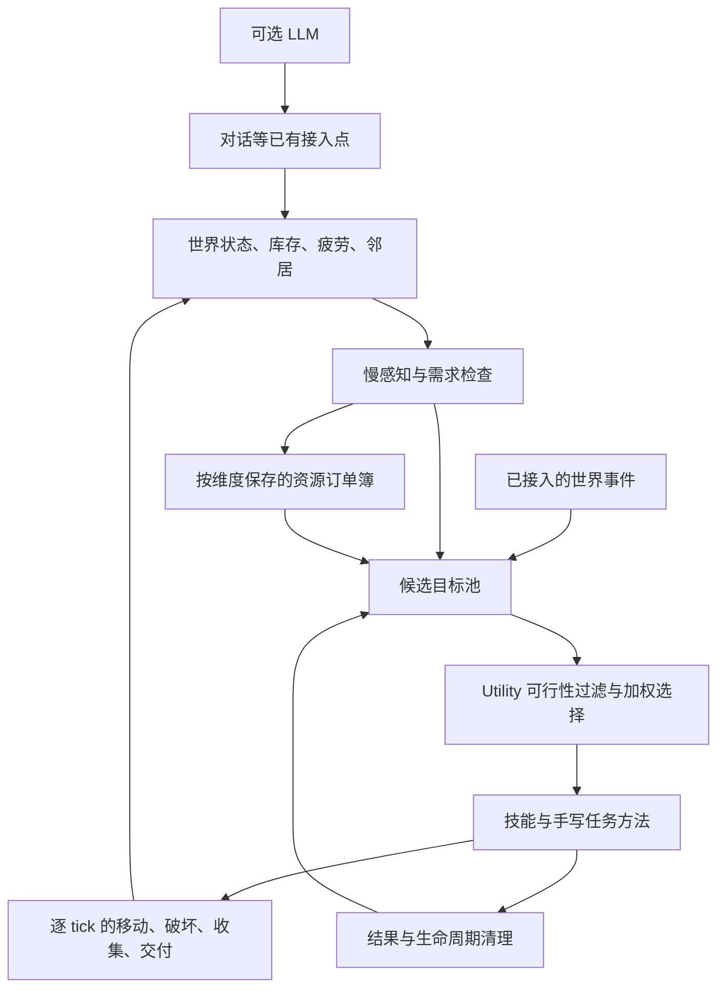
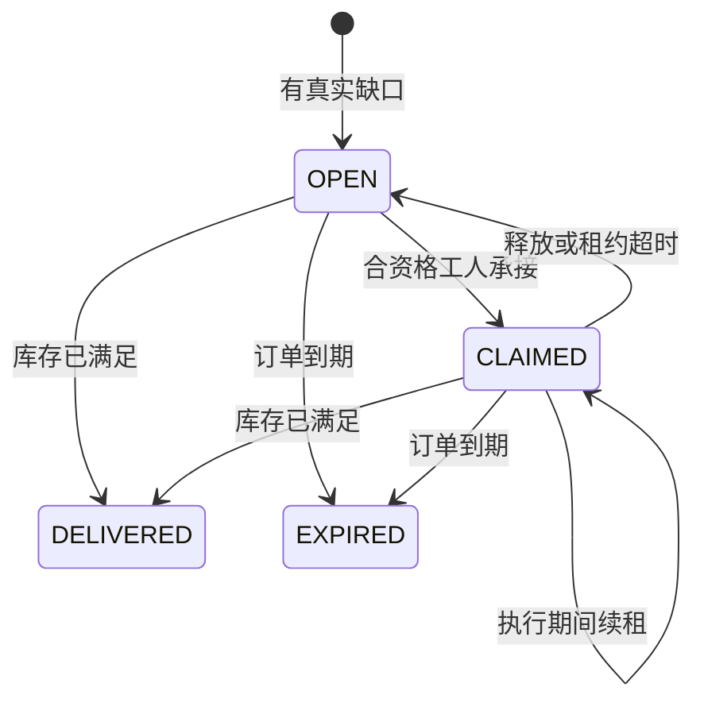

# 事件与需求驱动的大脑、资源订单（当前实现）

核对日期：2026-10-23。本文对应当前工作区源码，说明主循环、目标退出和资源订单。

本文面向实现与维护；面试表述见 [村民 Agent 系统面试讲述](村民Agent系统面试讲述.md)。运行背景为 Minecraft 1.16.5 / Forge，核心调度和世界操作在游戏服务端线程执行。

## 架构选择

采用 Utility 选意图 + 规则任务分解 + 连续动作执行。当前资源订单采用 HTN 思路，具体实现是有限领域内的手写条件分解和状态推进；没有引入通用 HTN 搜索引擎，也没有实现 GOAP。

| 概念 | 负责什么 | 木材需求示例 |
|---|---|---|
| Utility AI | 此刻想做什么 | 比较接单、收割、聊天、闲逛、休息的价值，在可行项中加权抽样 |
| HTN（Hierarchical Task Network，分层任务网络） | 按预先定义的方法分解任务 | 供货 → 核对库存 → 准备工具 → 找树 → 走近 → 砍伐 → 收集 → 交付 |
| GOAP（Goal-Oriented Action Planning，目标导向动作规划） | 根据动作前提、效果和成本搜索路径 | 要木材 → 搜索自己砍、购买、交换等组合中当前可行的路线 |

HTN 不等于按时间执行；它规定完成任务的方法。GOAP 也不意味着自由随机行为；它仍依赖开发者正确建模动作和世界状态。两者都能在无 LLM 时运行。

任务方法明确控制工具、采收结果、寻路和交付；其覆盖范围由各技能的方法体决定。

### 模块关系



这里的“自由”来自当前状态改变候选和权重，以及选择过程保留概率；行为仍受技能、资源、职业和世界规则约束。每个村民有独立目标与动作状态，多村民通过订单共享需求，不依赖多人轮流调用 LLM。

## 当前链路

1. 慢感知更新局部农业机会、已记忆农田、可交谈邻居、需求、职业资格；事件可添加额外目标。
2. `GoalScheduler` 根据当前需求、机会、最近完成的任务和冷却加权抽样，夜间休息优先于普通工作，其他行为仍按状态评分。
3. 正在执行的任务保持连续性；完成动作且持续了一小段时间后，可重新选择。紧急目标可抢占；正分且可执行的非漫游目标也可打断 wander。
4. `processGoals` 每个服务端 tick 推进动作；身体执行频率独立于 `BEHAVIOR_EXECUTOR_INTERVAL_TICKS`。`AGENT_THINK_INTERVAL` 仅控制感知和候选维护。
5. `WAITING` 释放动作和订单租约，稍后重试。`SUCCESS/FAIL/DELETE` 统一清理，保留与重试由 `GoalExitPolicy` 决定。不能用无限 `RUNNING` 代替等待材料。
6. 成年受管村民由自定义 Brain 持续接管，使用原版导航物理。幼年村民保留原版行为。

疲劳达到 45 后才选择睡眠，夜间优先于普通工作并持续到黎明；白天也可因疲劳休息，恢复到 10 后结束。睡着时不再增加清醒疲劳。当前需求仍是简化数值模拟，不是完整生理系统。

### 决策节奏与动作连续性

| 层次 | 当前节奏或条件 | 目的 |
|---|---|---|
| 身体执行 | 每个服务端 tick 推进 | 破坏进度、移动、收集能连续发生 |
| 感知和候选维护 | `AGENT_THINK_INTERVAL`，默认 100 ticks | 避免每 tick 全量更新环境 |
| 普通重新考虑 | 间隔至少 20 ticks；已有目标需持续至少 200 ticks，且处于无当前动作、未睡眠的边界 | 减少工作与聊天之间不断抖动 |
| 紧急目标 | 可行目标中优先级 ≥ 9 | 允许跳过普通选择；战斗另有接管路径 |
| 外部条件等待 | `WAITING` 后由退出策略设置 200 ticks 冷却 | 释放执行机会，稍后再检查 |

20 TPS 时，100 ticks 约为 5 秒；服务器卡顿会使实际墙钟时间变长。这里保留的是执行频率、最小持续时间和重试冷却，不是“白天工作、晚上聊天”的作息表。

系统是**周期感知加有限事件接入**。当前不能把所有机会都描述为事件推送；`WorldEventBus` 中存在事件类型也不表示每种游戏变化都已完整接入。已有分层空间感知保留，但 Utility 并未使用其全部信息。

### 工作优先级

寻找工作站、现货交付的优先级下限为 8；农耕、制作、资源订单为 7；补货、获取物品、收集及交易为 6。旧存档目标在执行器维护时同步提升到下限，已有 9–10 紧急优先级保留。社交为 3，普通漫游为 2 且仅作为兜底。疲劳达到 45 的夜间或白天疲劳达到 80 时，休息优先于普通工作并可打断 farming；优先级 9–10 的紧急目标仍优先。上述优先级参与 Utility 加权，并非严格按整数排序；普通工作不会互相抢占，紧急阈值仍为 9。

### Utility 如何选择

先排除已完成、已挂起、已过期或正在冷却的目标，再计算：

```text
基础分 = max(1, priority) × max(0.1, weight)
最终分 = 基础分 × 当前机会/需求修正 × 最近行为修正
普通候选的选择概率 = 最终分 / 所有可行候选最终分之和
```

这是直接按权重抽样，没有做 softmax。可行紧急目标优先，不进入普通概率竞争。普通 wander 只在没有其他正分且有 handler 的目标时参与抽样，是兜底行为。

| 候选 | 当前主要修正 |
|---|---|
| 种田 | 本地农业机会加可重访农田锚点参与评分；本地无维护工作时可前往远处记忆农田，现场重新确认。见[空间感知](vision_module_implementation.md) |
| 睡眠 | 日夜均需疲劳达到 45；夜间可打断普通工作，白天达到 80 可打断普通工作 |
| 聊天 | 必须有候选邻居且满足间隔；距离上次聊天越久越倾向聊天，性格可加权 |
| 接资源订单、交付现货交易 | 权重乘 2.5 |
| 重复制作 | 目标物品库存达到 8 时停止该常规候选 |
| 补货 | 没有零库存的必需品时不选 |
| 闲逛 | 无其他正分可执行目标时兜底；高疲劳时降低权重 |
| 最近完成过的同类目标 | 600 ticks 内权重乘 0.3 |

例如某次实际计算后，种田、接单、聊天得分分别为 3、5、2，则普通选择概率分别为 30%、50%、20%。这是解释公式的假设数据，不是固定配置或实测统计。加权随机提高多样性，但不提供严格的无饥饿保证，也不保证村民按固定比例轮流行动。

### 技能结果与清理约定

| 结果 | 含义与处理 |
|---|---|
| `RUNNING` | 当前步骤仍在有效推进，下一 tick 继续 |
| `WAITING` | 等外部资源、订单或可达条件；释放动作与租约，目标冷却后重试 |
| `BLOCKED` | 有明确失败原因，例如缺少合格工具；尝试生成补救目标，有限重试 |
| `SUCCESS` | 当前技能目标完成；清理身体状态，按目标生命周期移除或安排再次执行 |
| `FAIL` / `DELETE` | 本轮不可继续或目标失效；退出并清理 |

`ActionLifecycle` 统一清除破坏裂纹、停止导航、释放订单租约、清理当前动作及相关状态。任务切换不能只改 `currentGoal` 而留下旧的导航或方块破坏进度。移动卡住检测依据实际位移重置计数，不能仅因路程较长就判定卡住。

**技能成功不等于订单结单。** 交付一个批次可以返回 `SUCCESS`；订单是否满足由需求方库存核对决定，仍有缺口时后续可以再次产生供货目标。

### 目标退出与重试

`GoalExitPolicy.retain` 是退出策略的事实入口：

- `SUCCESS` 清零失败计数；一次性目标移除，可重复目标保留，清理目标位置与农耕模式，冷却至少 100 ticks。
- `WAITING` 保留目标，冷却 200 ticks，失败计数保持不变。
- `BLOCKED(MISSING_ITEM)` 保留补料依赖并冷却 200 ticks，不消耗失败额度。其他 `BLOCKED/FAIL` 累计失败，达到 3 次时移除；UNREACHABLE 重试间隔为 200 ticks，其他失败至少 200 ticks 或使用目标原有冷却。
- `DELETE` 直接移除。可重复目标因非成功结果被移除后，`RoutineScheduler` 至少等待 1200 ticks 才可重新播种。
- 当前非睡眠目标持续执行达到 2400 ticks 会返回执行超时失败；连续农耕每次真实操作成功刷新此计时，子动作间隙不触发普通边界切换；导航失败也会进入退出协议。

`REPEATABLE` 表示具备重复生成与完成后冷却的生命周期。技能实例为单例；每村民状态放在 `VillagerAgentData`、`BrainRuntime` 或动作对象中，并按实际 NBT 字段判断是否持久化。

## 职业与订单

`LUMBERJACK`（伐木工）和 `MINER`（矿工）是持久化的 **agent 职业角色**，不替换原版 VillagerProfession 注册表，不新增职业贴图或专属工作站。角色与原版职业分别保存，因此不依赖原版作息和 POI 切换。

- 有合适需求时，附近无业成年村民可以自动加入资源职业；也能使用命令指定。
- 首次资源授职提供一把基础工具，沿用现有职业的启动物资约定。更换角色不能重复领工具。
- 日常 `restock` 提交真实物资请求。首次原版职业授予提供启动物资。
- 职业决定承接资格；Utility 决定此刻是否开始执行。
- 所有维度分别保存自己的 `WorkOrderSavedData`。
- 同一需求方、同一物品的活跃请求合并，以目标库存为完成条件。
- 单个订单只允许一个有效承接者；单个工人不能同时持有两张有效租约。
- 活动执行续租；中断释放；离线超时释放。重载保留需求，但清除执行租约，从世界与库存重建计划。
- 可以分批交付，只有需求方真实库存达到目标才结单。
- 物品插入按实际容纳数量转移，满背包不会让货物凭空消失。
- 订单过期后不继续占用工人；持续的真实库存缺口会重新产生请求。

需求来源包括经济系统的职业必需品缺口、技能失败的材料补救、获取物品任务，以及调试命令。经济系统会给有解锁配方的村民创建生产目标，现货交付通过 `deliver_trade` 进入统一执行器。

当前原料订单直接交付给需求方，沿用合作供给思路；订单业务范围为需求和供给，不含报价、预付款或违约罚款；现货交易使用绿宝石结算。

### 订单数据与状态机

订单记录 `id`、需求方、物品、所需职业、目标库存、剩余缺口、到期时间、承接者和租约到期时间。目标库存采用：

```text
remaining = max(0, targetStock - requesterActualStock)
合并活跃请求时：targetStock = max(oldTargetStock, newDesiredStock)
```



枚举中还有 `CANCELLED`，当前没有完整的显式取消命令或业务流程，因此不把它画作已接通的转移。

必须维持的规则：

1. 同一需求方和物品只合并活跃订单；结单后再次消耗可以产生新订单。
2. 工人不能承接自己的请求；职业必须匹配。
3. 一张订单至多有一个有效承接者，一个工人至多持有一张有效租约。
4. 候选目标只是意向，实际执行时才 `claim`；多个村民同时看到机会不等于同时获得执行权。
5. 租约为 600 ticks，活动执行续租；订单生命周期为 24000 ticks。按 20 TPS 分别约为 30 秒、20 分钟；订单维护会处理超时。
6. 重复请求可以刷新订单到期时间。超时是恢复机制，不是交货时限或商业承诺。
7. 礼物、普通交易也可能满足库存；`DELIVERED` 在此表示需求已满足，不证明所有货都来自原承接者。

`WorkOrderBook` 是单线程的纯 Java 账本。排他性来自服务端顺序调用下的资格和所有权检查，不是分布式锁。当前库存转移与存档也不是数据库事务，不能宣称跨崩溃 exactly-once。

### 一次木材需求如何闭环

假设 A 有 2 个橡木原木，需要库存达到 10；附近 B 是伐木工：

1. A 提交 `targetStock=10`，订单缺口为 8。重复检查同一缺口合并到活跃订单，不每次新增一张。
2. B 的慢更新看到合适订单，加入 `fulfill_order` 候选。附近合资格无业村民也可以先获得资源角色。
3. 候选分配时先预留订单，再创建供货目标及分配资源职业。Utility 选中供货后 B 在执行入口续租或重新承接；被其他工人承接时删除过时目标，让出身体。
4. B 检查自身库存。库存足够就配送；不足则检查工具、寻找局部暴露且可达的天然树候选。
5. 走近后逐 tick 破坏一个方块，再用收集窗口拾取真实掉落；下一次检查背包确认所得。
6. 达到本批数量后走向 A。常规批次上限为 8；资源不足但已有部分货物时也可以先交小批。
7. 靠近后按双方实际可转移数量移交。若只放入 3 个，A 库存为 5，缺口仍为 5；本次供货技能可以结束，订单仍然活跃。
8. A 实际库存达到 10 才满足需求。若期间被消耗，则按新的实际库存继续核对。

缺工具进入补救；找不到资源进入等待，之后可能通过其他闲逛行为改变位置。当前没有专门为缺矿订单规划远距离探索路线。原料采集与现有配方生产是两条相接的业务路径，尚未构成任意深度的自动产业链规划器。

## 采集方法与限制

`ResourceCatalog` 目前支持：

- 橡木、云杉、白桦、丛林、金合欢、深色橡木原木。
- 煤、铁矿石、金矿石、钻石、红石、青金石、圆石。

Minecraft 1.16.5 的铁矿采收产物是铁矿石。铁锭加工使用制作/配方系统；这条链路的范围是配方解析与物料转换，完整炉子投料、燃料和出炉交互需要单独核验。

资源传感器只检查已加载的局部区域，要求方块至少有一侧暴露在空气中，并验证附近站位可达；工人可以绕到树木另一侧，不要求从当前位置直视目标。埋在地下、四周无空气的矿石不会成为候选。未发现资源时让位给其他任务，包括现有探索/闲逛，然后重试。

当前覆盖“暴露且可到达的矿石、树木可达部分”。地下掘进、修楼梯、搭脚手架采高树、整树作业、系统化补种和远距离资源运输仍需要独立任务方法。自然树判定采用附近非持久树叶的启发式，不等同于完整自然地形/玩家建筑所有权识别。

破坏动作具有工具选择、正确采收工具检查、按工具计算的破坏时长、挥手与裂纹、实际掉落、工具耐久、距离/方块变化后的进度处理，并经过 Forge 方块破坏事件。放置使用真实物品的使用上下文和 Forge 放置入口，消费背包方块。

资源搜索当前检查横向半径 10、纵向 -4 至 +5 的局部范围，过滤未加载区域；候选按距离排序，最多检查 8 个资源方块、24 条站位路径。限制查询范围和探测次数是预算控制，并不构成已验证的性能结论。

破坏使用 FakePlayer 上下文，依据玩家破坏公式和所选工具推进进度，并计算实际掉落、经验和工具损耗。不能据此断言所有药水状态、附魔或第三方模组交互都与真实玩家完全等价；这些需要游戏内验证。放置能力已接入动作层，但不等于已有完整自主选址和建筑规划能力。

## 无 LLM 与有 LLM

无 LLM 时，大脑、接单、采集、交付、关系更新和本地村民对话继续运行。接近邻居只产生聊天机会，由同一调度器决定是否聊天。

配置 LLM 后，社交走同一入口生成更丰富的内容；失败回退本地台词，异步结果回服务端线程应用。玩家对话、想法等接入点见 [LLM 与世界交互](LLM与世界交互.md)。当前自主规则链路的目标来源为候选维护、需求和已接入事件。LLM 不直接操作世界，也不能生成尚未实现的底层能力。

社交通过统一目标选择启动。对话回调在服务端线程应用时检查实体与距离等条件，避免请求返回后对已经失效的场景继续操作。

## 保存、恢复与扩展边界

| 数据 | 当前策略 |
|---|---|
| 资源职业、启动工具领取标记 | 随村民数据保存，换职业不重复领取 |
| 活跃订单的需求字段 | 每维度 `WorldSavedData` 保存 |
| 订单承接者和执行租约 | 不恢复；读档后重新开放承接 |
| 具体破坏进度、当前动作及技能临时计划 | 不做精确断点持久化；从当前库存与世界重建 |

恢复目标是“需求仍存在、重新判断怎么做”，不是恢复到上次执行的某条指令。世界和实体数据使用游戏的保存机制，不保证多文件原子提交。

新增采集类资源通常需要扩充 `ResourceCatalog`，定义产物、来源方块、工具和职业资格；如果操作方法不同，还需新技能方法。新增行为需要候选来源、评分条件、技能执行、完成证据及退出清理，不能只增加一句 LLM 提示词。

## 源码入口

以下链接相对于本文，按执行链排列。

| 职责 | 入口 |
|---|---|
| 主循环与目标结果处理 | [VillagerAgentManager](../src/main/java/com/github/AaronAA0721/villageragent/ai/VillagerAgentManager.java) |
| 概率选择和条件权重 | [GoalScheduler](../src/main/java/com/github/AaronAA0721/villageragent/ai/GoalScheduler.java) |
| 常规候选与机会感知 | [RoutineScheduler](../src/main/java/com/github/AaronAA0721/villageragent/ai/RoutineScheduler.java)、[OpportunitySensor](../src/main/java/com/github/AaronAA0721/villageragent/ai/OpportunitySensor.java) |
| 动作退出与释放 | [ActionLifecycle](../src/main/java/com/github/AaronAA0721/villageragent/ai/ActionLifecycle.java) |
| 订单状态与保存 | [WorkOrderBook](../src/main/java/com/github/AaronAA0721/villageragent/ai/work/WorkOrderBook.java)、[WorkOrderSavedData](../src/main/java/com/github/AaronAA0721/villageragent/ai/work/WorkOrderSavedData.java) |
| 需求接入与职业授予 | [ResourceWorkSystem](../src/main/java/com/github/AaronAA0721/villageragent/ai/work/ResourceWorkSystem.java) |
| 采集与交付任务方法 | [ResourceWorkSkill](../src/main/java/com/github/AaronAA0721/villageragent/ai/behavior/ResourceWorkSkill.java) |
| 资源范围与感知 | [ResourceCatalog](../src/main/java/com/github/AaronAA0721/villageragent/ai/work/ResourceCatalog.java)、[ResourceSensor](../src/main/java/com/github/AaronAA0721/villageragent/ai/work/ResourceSensor.java) |
| 世界操作与数量转移 | [BlockInteractionAction](../src/main/java/com/github/AaronAA0721/villageragent/ai/BlockInteractionAction.java)、[InventoryTransfer](../src/main/java/com/github/AaronAA0721/villageragent/ai/InventoryTransfer.java) |
| 工具缺失等补救 | [FailureRecoveryPlanner](../src/main/java/com/github/AaronAA0721/villageragent/ai/FailureRecoveryPlanner.java) |
| 订单规则自动检查 | [WorkOrderBookChecks](../src/test/java/com/github/AaronAA0721/villageragent/ai/work/WorkOrderBookChecks.java) |

## 调试与验收

命令作用于距离执行者最近的受管村民：

```text
/va occupation lumberjack
/va occupation miner
/va occupation none
/va request minecraft:oak_log 8
/va request minecraft:iron_ore 4
/va orders
```

`request` 表示让这个村民请求新增数量的物资；自己不能接自己的外部订单。先在需求方附近发请求，再在另一村民附近设定职业，或者等待无业村民自动响应。需要开启 AI、世界交互和经济系统。资源职业首次授予会给一把基础工具，钻石/金矿等仍需要合格铁镐。

建议在测试存档做以下场景：

1. 不配 LLM，两个成年村民、天然树和可达露天矿。观察接单、逐块破坏、收集、走回交付；对照双方背包与 `/va orders`。
2. 两个工人竞争一张订单，确认只有一人有效承接；工人卸载或受惊后另一人能接续。
3. 矿工拿不合适的镐，确认不凭空产矿，而是请求工具或等待。
4. 需求方背包满、供应方只有部分货，确认数量守恒且未错误结单。
5. 任务期间移除目标矿石、阻断路径、让双方拉开距离，确认超时/等待后能做别的事。
6. 保存退出后重进，需求和职业仍在，执行租约重新领取。
7. 疲劳高时白天可休息，夜里疲劳达到 45 后优先找床睡觉；种田与聊天都无需 LLM。

自动检查入口：`gradlew workOrderChecks` 或 `gradlew check`。纯 Java 订单检查覆盖请求去重、独占承接、租约续期/失效、部分交付、外部库存满足、再需求和维度账本隔离。编译和这些检查不能代替 Minecraft 场景验收。

验证范围与当前检查入口见 [调试手册](DEBUG_VERIFICATION.md)。

## 丢出与主动拾取原语

`drop_item`、`pickup_item` 是无职业门槛的显式目标，受 `enable_world_interaction` 控制，通过 `BehaviorExecutor` 执行，可由 `GoalParser` 的 TODO 指令创建：

```text
TODO: drop_item minecraft:oak_log x3
TODO: pickup_item minecraft:oak_log x3
TODO: pickup_item minecraft:oak_log x3 <掉落实体UUID>
```

`drop_item` 的数量表示本次要丢出的数量，执行中 `targetQuantity` 递减为剩余量；省略数量默认 1。`pickup_item` 只负责接近目标，数量字段不用于验收。丢出从真实库存逐槽复制完整 NBT，生成实体成功后才扣库存，附带投掷速度和 40 ticks 拾取延迟。缺货进入材料补救，生成被取消时保留未丢出的数量。

主动拾取首次查询村民周围 16 格盒内的匹配掉落物，随后缓存 UUID，通过 `ServerWorld.getEntity(UUID)` 读取移动后的实时位置；目标失效时至多每 20 ticks 重查一次，寻路至多每 10 ticks 重发。指定 UUID 时不替换目标；目标不可用时结束接近任务，不验证是否已经被吸取。按种类寻找时可重新选择合并后的实体。累计执行超过 600 ticks 失败，避免长期占用身体。

主动拾取（包括农田捡拾子任务）只负责走近掉落物，到达即完成，不检查物品是否到账，也不直接修改库存或掉落实体。实际收取始终由被动吸取负责，执行期间不会暂停被动吸取；附近已经可吸取的农作物不再重复生成接近任务。

入口：`ai/behavior/DropItemSkill.java`、`ai/behavior/PickupItemSkill.java`。游戏内仍需验证水流移动、合并、竞争拾取、满背包、路径阻断、区块卸载和中断恢复。

## 通用根任务与子任务

`GoalQueue` 只保存供大脑选择的根任务。`TaskExecution` 为运行中的根任务维护一棵瞬时执行树，每个节点最多一个活跃子节点，可以继续嵌套；每个节点有独立的类型化局部状态。`BehaviorExecutor.executeChild` 使用与根任务相同的技能注册表、能力门控和结果协议执行子任务。子任务 SUCCESS/FAIL/BLOCKED/WAITING/DELETE 返回给父任务，由父任务决定继续、换目标还是结束；不会直接进入根任务的退出策略或恢复规划。

技能声明 `isComposite()` 后，普通的动作间隙不再触发根任务轮换；优先级达到抢占条件的紧急根任务仍可中断它。调度器不依赖 `farm` 名称。取消、结束、过期或抢占时，`ActionLifecycle` 停止身体动作并递归释放执行树中的订单租约，清空全部节点状态。下次运行从当前世界重建，不恢复半截动作。任务树与根候选均不做精确断点存档。

`farm` 已接入：前往农田是 `move` 子任务，随后循环 `collect_crops` / `harvest` / `plant` / `till`。田块中心、已拒绝位置、步数和等待时间属于 farm 节点，不再占用 BrainRuntime 的 farming 专属字段。单个目标不可达时父任务跳过该目标并检查其他工作；无可执行工作时才返回根结果。`sleep/rest` 同样是复合根任务：找床、调用移动子任务（2 格内到达）、入睡并保持到醒来。遍历建筑内全部床，未索引时局部查床，床占用或路径失败时尝试其他床。其他高层技能仍可作为普通叶节点运行。

任务来源由代码赋予 `RULE` / `LLM` / `PLAYER`，默认 RULE。技能声明 `isPrimitive()` 后，规则无法通过根队列提交它；LLM/玩家可以。内部子任务不进入根队列，因此规则执行器可以调用这些原语。根派发再次校验来源。`GoalParser` 与 Harness 接入点赋予 LLM 来源，来源不从模型输出文本读取。

可独立提交的农田动作使用方块坐标：`TODO: harvest <x> <y> <z>`、`TODO: plant <x> <y> <z>`、`TODO: till <x> <y> <z>`、`TODO: collect_crops <x> <y> <z>`。播种与翻地坐标是土地方块，收割坐标是作物方块。原子动作仍检查能力、工具、种子与现场条件。

日志 `task-child-start` / `task-child-exit` 记录任务路径（例如 `farm/harvest`）、目标、结果和失败原因。`taskExecutionChecks` 检查三级嵌套、结果隔离、取消重建、来源限制与非 farm 复合任务的调度策略；实际寻路与田地变化需要游戏内验收。

农田收割成功后立即优先补种原作物，缺对应种子则使用现有智能选择器改种可用种子；空耕地继续生成播种子任务。播种/翻地寻路使用土块上方位置，实际放置成功后才消耗种子。

疲劳按清醒时长积分：闲暇每 1200 ticks 增加 4.5，工作增加 6（包含工作子动作之间的间隙）。从 0 开始清醒 12000 ticks，闲暇为 45、持续工作为 60；睡眠时不增长，不在黎明清零。导航按水平移动判断进展，原地上下跳不再重置卡住计时；停滞 40 ticks 后清除旧路径重寻，最多三次，有上升路径节点且头顶空余时辅助跳跃，持续失败交回任务退出协议。
